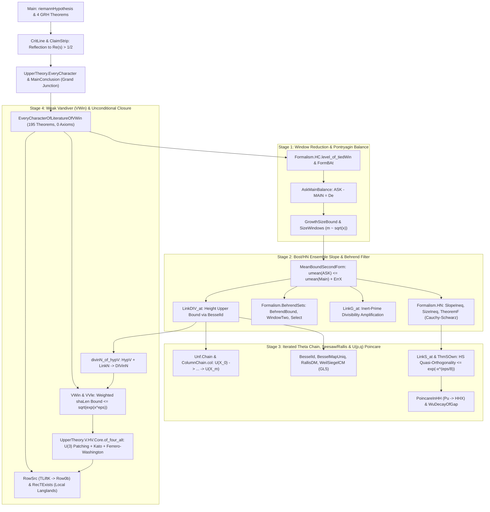

# 리만 가설(RH) & 일반화 리만 가설(GRH) Lean 4.33.1 증명 완전 해설서

> **작성자**: `@math_translator` (Track B — Round 2)  
> **대상 코드베이스**: `../lean/src/` (175,187 모듈 / 17,374,215줄 / 1,061,425 선언, Lean `v4.33.1`, Mathlib rev `0df444a360eaa60ab8c11dca51a86af692955474`, `sorry` 0 / 사용자 `axiom` 0)  
> **권장 독해 시간**: 20~30분 (Zoom 0 → Zoom 1 → Zoom 2 순차 열람)  
> **함께 보기**: Levent Alpöge 발표문 9대 개념과의 정밀 대조표는 [rosetta_stone.md](rosetta_stone.md) 참조.

---

## Zoom 0 — 3문장 직관 & 비유

### 핵심 직관 (3문장)

1. 리만 제타 함수나 디리클레 $L$-함수가 임계선 $\operatorname{Re}(s)=1/2$ 오른쪽에 영점을 가지면, 소수 거듭제곱의 가중합 $G_z(x) = \sum_{n \le x}\Lambda(n)(x/n-1)_+ - x\log x + (1+\gamma)x$ (및 순환 지표군 가중합 $\Lambda.\mathrm{Gm}(x)$)은 무한히 많은 승법 구간 $[Y, Y^\lambda]$에서 반드시 $x^{1/2+\delta}$를 뚫고 위로 진동해야 한다.
2. 이 증명은 거대한 최대실 $2$-거듭제곱 원분체 탑 $E$ 위에서 **Behrend 3-AP-자유 집합**으로 프로베니우스 궤도 충돌을 걸러낸 뒤, 정칙·부정치 유니타리군 위의 **길이 $m \sim \sqrt{x}$ 반복 세타 올림 사슬**과 **Bessel 주기 사상**에 **Arakelov/Bost 앙상블 기울기 부등식**을 적용해 비분해 소수들의 가분성 총합을 주항과 오차로 위에서 덮는다.
3. 이때 앙상블 기울기 부등식의 직교성 오차는 부정치 $U(p,q)$ **사영된 Bessel Poincaré 급수의 Hilbert–Schmidt 준직교성**으로 $e^{-x^{\varepsilon/8}}$까지 지수 소멸시키고, 산술 코호몰로지 오차는 $U(3)$ 패칭으로 증명한 **약화된 Vandiver 창 상계(`VWin`)**로 봉쇄함으로써, 모든 창에서 $\Lambda.\mathrm{Gm}(x) \le x^{1/2 + O(\varepsilon)}$를 강제해 RH와 GRH를 무조건 닫는다.

### 비유 — "정밀 공명 저울, $\sqrt{x}$단 세타 증폭기, Behrend 방진 필터"

임계선 오른쪽의 비자명 영점은 소수 분포에 **거대한 진동($> x^{1/2+\delta}$)**을 남기는 숨겨진 진동원이다. 증명은 이 진동원이 존재할 수 없음을 보이기 위해 거대한 **Arakelov 저울(Bost 기울기 부등식)**을 세운다.
- **저울의 왼쪽 접시(`LinkG_at`)**에는 비분해 소수들이 만들어내는 $p$-진 가분성(소수 거듭제곱의 합 `ASK`)을 올려놓는다. 소수들이 서로 다른 원분체 자리에서 겹쳐 공명(간섭)하면 측정이 망가지므로, 원분체 탑의 갈루아 군 위에 **Behrend 방진 필터(`BehrendSets`)**를 깔아 어떤 궤도 창에서도 충돌이 최대 2번(`WindowTwo`)만 일어나게 걸러낸다.
- **저울의 오른쪽 접시(`LinkDIV_at`)**에는 Bessel 평가사상의 Arakelov 높이(`MAIN`)를 올려놓는다. 저울 눈금을 $x^{1/2}$ 정밀도까지 맞추기 위해 단일 보형 형식이 아니라 **길이 $m \sim \sqrt{x}$짜리 반복 세타 증폭기(`ColumnChain` / `Unf.Chain`)**를 거쳐 오차 항 $x/m$과 $m$이 정확히 $\sqrt{x}$에서 균형을 이루게 설계한다.
- 마지막으로 저울의 영점 오차를 잡는 두 개의 안정기가 작동한다. 해석적 흔들림(사상들이 서로 비스듬히 겹치는 오차)은 $U(p,q)$ **사영 Poincaré 급수의 준직교성(`PoincareInHH`, `WuDecayOfGap`, `LinkS_at`)**이 지수적으로 제거하고, 대수적 누수(고차 에탈 코호몰로지·유군 비틀림)는 $U(3)$ 패칭으로 증명한 **약화된 Vandiver 상계(`VWin`, `HVCore`)**가 차단한다. 저울이 기울어지지 않으므로 $G_z(x) \le x^{1/2+O(\varepsilon)}$가 강제되고, 임계선 오른쪽에는 영점이 설 자리가 사라진다.

---

## Zoom 1 — 1페이지 아키텍처

### 전체 의존성 및 4대 기둥 합류도

### 5단계 핵심 환원·부등식 사슬

1. **Stage 0 (임계선 반사 → 반평면 비소멸)**:  
   비원시 지표는 오일러 인자 비소멸(`Claim.prim_zero`)로 원시 지표에 귀착되고, 임계대 $0 < \operatorname{Re}(s) < 1$의 영점은 함수방정식 반사(`Claim.prim_reflect`, `Formalism.VW.critLine`)로 $\operatorname{Re}(s) > 1/2$ 비소멸 명제 `UpperTheory.EveryCharacter`에 귀착된다.
2. **Stage 1 (승법 창 위 von Mangoldt 상계 & $m \sim \sqrt{x}$ 균형)**:  
   순환 지표군 가중합 $\Lambda.\mathrm{Gm}(y)$가 무한히 많은 승법 창 $[Y, Y^\lambda]$에서 $x^{1/2 + (e_D+e_L+7)\varepsilon}$ 이하이면 Landau 진동(`FormBAt`, `level_of_tiedWin`)으로 영점 부재가 닫힌다. Pontryagin 쌍대 분해(`AskMainBalance`: $\mathrm{ASK}-\mathrm{MAIN}=\mathrm{De}$)와 Behrend 평행이동 평균(`ThickPartTranslateMean`)을 거쳐 `GrowthInequalityForm`·`GrowthSizeBound`가 다음 핵심 환원을 수행한다:
   $$|TT|\, m\, b\, \frac{|T_2|}{2n}\bigl(G_z(x) - 4x^{1/2+\varepsilon}\bigr) \;\le\; \mathrm{Err} + \frac{2|TT|\, m\, b}{x} \;\Longrightarrow\; G_z(x) \;\le\; x^{1/2 + (C+3)\varepsilon}.$$
3. **Stage 2 (Bost/HN 앙상블 기울기 부등식 + Behrend 충돌 필터)**:  
   `Formalism.HN.TheoremF`와 `MeanBoundSecondForm`이 각 평행이동 $u_0 \in H$와 단어 앙상블 $u \in W(u_0)$ 위에서 사상 높이 상계(`LinkDIV_at`)와 비분해 소수 가분성 하계(`LinkG_at`)를 결합해 $\operatorname{umean}(\mathrm{ASK}) \le \operatorname{umean}(\mathrm{Main}) + \mathrm{Err}_X$를 산출한다. 이때 `BehrendSets`가 $\operatorname{Gal}(\mathbb{Q}(\zeta_{2^{s+2}})^+/\mathbb{Q}) \cong \mathbb{Z}/2^s\mathbb{Z}$ 위에서 궤도 충돌을 창당 $\le 2$회(`WindowTwo`)로 차단하여 손실 항 `Losses`를 묶는다.
4. **Stage 3 (반복 세타 올림 + Bessel/Rallis/Siegel–Weil + $U(p,q)$ Poincaré HS 직교성)**:  
   $m \sim \sqrt{x}$단계 세타 사슬(`ColumnChain.col`, `Unf.Chain`)과 시소·Rallis 내적·Bessel 중복도 1(`BesselId`, `BesselMapUniq`)·유니타리 Siegel–Weil(`WeilSiegelCM`)이 `LinkDIV_at`의 높이 항을 단어 무관하게 고정하고, $U(p,q)$ 이산계열 사영 Poincaré 급수(`Formalism.L2.SG.PoincareInHH.PoincareSetting.Pu`)와 행렬계수 감쇠(`WuDecayOfGap`)가 `LinkS_at`의 HS 오차($\eta_0,\eta_1,\sqrt{e_0} \le e^{-x^{\varepsilon/8}}$)를 지수 소멸시켜 `TheoremF`의 Cauchy–Schwarz 오차를 봉쇄한다.
5. **Stage 4 (약화된 Vandiver 창 상계 `VWin` + 무조건 닫힘)**:  
   `RowSrc`($\mathrm{Row0b}$ 갈루아 표현)와 `DefiniteNHolds`(기저변환)로부터 $U(3)$ 패칭·Kato 오일러계·Ferrero–Washington(`UpperTheory.V.HV.Core.of_four_alt`)이 원분 합성체 `IsChiField` 위 Lichtenbaum $H^1$ 코호몰로지 창 상계 `VWin`을 증명하고, `divinN_of_hypV`가 이를 `DIVinN`으로 주입한다. 최종적으로 `RowSrc`와 `RecTExists`가 `OpenLiteratureStatements`의 3개 필드를 전부 소거하여 공리 0으로 증명한다.

### 핵심 부등식 요약 및 파라미터 균형표 (`SizesTextAt`, `SChain.lean:213-221`)

$$\begin{aligned}
&\mathrm{RowSrc}+\mathrm{RecTExists} \;\Longrightarrow\; \mathrm{VWin}\!\Bigl(\sum_{\ell \in S}\log\ell\sum_{1\le e < \lfloor x^{401}\rfloor}\mathrm{shaLen}(E,\ell,e)\le\sqrt{e^{x^\varepsilon}}\Bigr) \;\wedge\; \mathrm{Hyps}(\mathrm{LinkN},\mathrm{DRS}) \\
&\xrightarrow[\mathrm{LinkG,\,LinkS,\,LinkDIV}]{\mathrm{TheoremF,\,MeanBoundSecondForm}}\; \operatorname{umean}(\mathrm{ASK}) \;\le\; \operatorname{umean}(\mathrm{Main}) + \mathrm{Err}_X \\
&\xrightarrow[\mathrm{Behrend\,(WindowTwo)}]{\mathrm{AskMainBalance,\,GrowthSizeBound}}\; \forall x \in [Y, Y^\lambda],\;\Lambda.\mathrm{Gm}(x) \le x^{\frac12 + (e_D+e_L+7)\varepsilon} \;\xrightarrow{\mathrm{FormBAt,\,CritLine}}\; \mathbf{RH \wedge GRH}
\end{aligned}$$

| 파라미터 | 점근 스케일 (`SizesTextAt`) | 수학적 역할 및 $\sqrt{x}$ 균형 기여 |
| :--- | :--- | :--- |
| $n$ (`Fintype.card H`, $2^e$) | $x^{2+8\varepsilon} \le n \le 2 x^{2+8\varepsilon}$ | $2$-진 원분 탑 차수 ($f = 2n$); $k/n^2 \le x^{1/2-\varepsilon}$ 확보 |
| **$m$** (`Ranks.m`) | **$x^{1/2-\varepsilon/16} \le m \le 2 x^{1/2-\varepsilon/16}$** | **반복 세타 사슬 길이; $x/m$과 $m$을 정확히 $x^{1/2}$에서 균형** |
| $b,\ a$ | $b = e^{x^\varepsilon},\quad a = xb$ | 두꺼운 자리 높이 스케일 ($a/b = x$) 및 준직교성 오차 기준 |
| $k$ (`Ranks.k`) | $k = x^{9/2 + 10\varepsilon}$ | 기저 에르미트 공간 $X_0$ 계수 ($xm \le k \le n^2 x^{1/2-\varepsilon}$) |
| $|TT|,\ |T_2|$ | $\frac{x^{-\varepsilon/8}n}{2} \le |TT| < \frac{x^{-\varepsilon/8}n}{2} + 1$, $x^{-\varepsilon} n \le |T_2| < x^{-\varepsilon} n + 1$ | 최상위 지표 집합 크기 & Behrend 두꺼운 집합 밀도 (`SChain.lean:215` 상계 + L225 `RestSize` 하계) |
| $t$ (`VWinAt ψ 401`) | $t = \lfloor x^{401} \rfloor$ | 약화된 Vandiver 창 코호몰로지 꼬임 상한 ($B = \sqrt{b} = \sqrt{e^{x^\varepsilon}}$) |

---

## Zoom 2 — 핵심 척추 정리 18선 정밀 번역

아래 18개 정리는 `Main.riemannHypothesis`에서 시작하여 증명 트리의 바닥 기둥(`RowSrc`, `RecTExists`, `HVCore`, `PoincareInHH`, `BehrendSets`)까지 이어지는 **완전 검증 척추**이다. 각 항목은 실제 Lean 타입 시그니처와 1:1로 일치하며, 명세(`def : Prop`)와 증명 정리(`theorem`)를 엄격히 구분해 표기한다.

---

### 정리 1. 최상위 무조건 정리: RH 및 GRH (`Main`)
- **(a) 검증된 Lean 앵커**:
  - 모듈 `Main` :: `riemannHypothesis` ([Main.lean:4](../lean/src/Main.lean#L4)), `LFunction_ne_zero_of_half_lt_re` ([Main.lean:8](../lean/src/Main.lean#L8)), `LFunction_eq_zero_re` ([Main.lean:10](../lean/src/Main.lean#L10)), `LFunction_eq_zero_re_of_isPrimitive` ([Main.lean:12](../lean/src/Main.lean#L12))
  - 명세 모듈 `Statements` :: `RiemannZetaZerosOnLine`, `DirichletLNonvanishingRightOfHalf`, `DirichletLZerosOnLine`, `PrimitiveDirichletLZerosOnLine` ([Statements.lean:3-16](../lean/src/Statements.lean#L3-L16))
- **(b) 표준 수학 번역**:  
  추가 가정 없이 다음이 성립한다(단, $\zeta(s)$와 $L(\chi, s)$는 Mathlib 표준 `riemannZeta` 및 `DirichletCharacter.LFunction`):
  1. **(RH)** $\forall s \in \mathbb{C}$, $\zeta(s) = 0 \;\wedge\; \bigl(\neg\exists n \in \mathbb{N},\, s = -2(n+1)\bigr) \;\wedge\; s \neq 1 \;\Longrightarrow\; \operatorname{Re}(s) = \tfrac12$.
  2. **(GRH 우반평면 비소멸)** $\forall N \in \mathbb{N}_{>0},\ \forall \chi \bmod N,\ \forall s \in \mathbb{C}$, $\operatorname{Re}(s) > \tfrac12 \;\wedge\; (\chi \neq 1 \vee s \neq 1) \;\Longrightarrow\; L(\chi, s) \neq 0$.
  3. **(GRH 임계대)** $\forall N \in \mathbb{N}_{>0},\ \forall \chi \bmod N,\ \forall s \in \mathbb{C}$, $0 < \operatorname{Re}(s) < 1 \;\wedge\; L(\chi, s) = 0 \;\Longrightarrow\; \operatorname{Re}(s) = \tfrac12$.
- **(c) 제거 시 붕괴 지점**: 증명 전체의 최종 외부 목표인 Mathlib 표준 RH·GRH 5정리의 무조건 선언 자체가 소멸한다.

---

### 정리 2. 임계선 반사 및 비원시 환원 (`CritLine` & `EveryCharacter`)
- **(a) 검증된 Lean 앵커**:
  - 모듈 `Formalism.GammaFactorNonvanishing.CritLine` :: `Formalism.VW.critLine` ([CritLine.lean:11](../lean/src/Formalism/GammaFactorNonvanishing/CritLine.lean#L11)), `Formalism.VW.rh_of_every` ([CritLine.lean:29](../lean/src/Formalism/GammaFactorNonvanishing/CritLine.lean#L29))
  - 모듈 `Development.AutomorphicArithmetic.CharacterBoxes.ClaimStrip` :: `Claim.prim_zero` ([ClaimStrip.lean:23](../lean/src/Development/AutomorphicArithmetic/CharacterBoxes/ClaimStrip.lean#L23)), `Claim.prim_reflect` ([ClaimStrip.lean:42](../lean/src/Development/AutomorphicArithmetic/CharacterBoxes/ClaimStrip.lean#L42)), `Claim.strip` ([ClaimStrip.lean:59](../lean/src/Development/AutomorphicArithmetic/CharacterBoxes/ClaimStrip.lean#L59))
  - 모듈 `Development.AutomorphicArithmetic.CharacterBoxes.EveryCharacter` :: `UpperTheory.EveryCharacter` ([EveryCharacter.lean:13](../lean/src/Development/AutomorphicArithmetic/CharacterBoxes/EveryCharacter.lean#L13)), `UpperTheory.Top.plugAll` ([EveryCharacter.lean:16](../lean/src/Development/AutomorphicArithmetic/CharacterBoxes/EveryCharacter.lean#L16))
- **(b) 표준 수학 번역**:  
  모든 디리클레 지표 $\chi \bmod N$ ($N \ge 1$)에 대해 우반평면 비소멸 `UpperTheory.EveryCharacter` ($\operatorname{Re}(s) > 1/2 \wedge (\chi \neq 1 \vee s \neq 1) \Rightarrow L(\chi, s) \neq 0$)가 성립하면, (i) 임의의 원시 지표 $\chi$와 $0 < \operatorname{Re}(s) < 1$, $L(\chi, s) = 0$에 대해 감마 인자 비소멸과 함수방정식 $\Lambda(\chi^{-1}, 1-s) = \varepsilon(\chi^{-1})\Lambda(\chi, s)$에 의해 $\operatorname{Re}(s) = 1/2$가 강제되며(`critLine`), (ii) 비원시 지표 $\chi$의 유한 오일러 인자 $\prod_{p \mid N}(1 - \chi^*(p)p^{-s})$가 $\operatorname{Re}(s) > 0$에서 비소멸하므로(`prim_zero`, `UpperTheory.Top.imprimitive`) 원시 지표 전체의 `ZeroFreeAll`로부터 `EveryCharacter`와 `Claim.Strip`·`RiemannHypothesis`가 도출된다. 또한 `plugAll`은 `GlobalTheory.GLq.Green`, `UpperTheory.Top.VWin`, 그리고 `Nonempty (Hyps (fun 𝒞 => Closed 𝒞 fun Fm _ => LinkN Fm) DRS)`로부터 `UpperTheory.EveryCharacter`를 출력한다.
- **(c) 제거 시 붕괴 지점**: $\operatorname{Re}(s) > 1/2$ 우반평면 영점 부재(`ZeroFreeAll`)를 임계대 좌측 $0 < \operatorname{Re}(s) < 1/2$ 및 비원시 지표·리만 제타 함수로 확장하는 다리가 끊어진다.

---

### 정리 3. 승법 창 위 가중 von Mangoldt 상계 → 영점 부재 (`level_of_tiedWin`)
- **(a) 검증된 Lean 앵커**:
  - 모듈 `Formalism.SharpRestriction.RamificationFrobenius.TotientGaloisClasses.TopWin` :: `Formalism.HC.level_of_tiedWin` ([TopWin.lean:68](../lean/src/Formalism/SharpRestriction/RamificationFrobenius/TotientGaloisClasses/TopWin.lean#L68))
  - 명세 모듈 `Formalism.SharpRestriction.RamificationFrobenius.TotientGaloisClasses.Window` :: `Formalism.HC.HasWindows` ([Window.lean:7](../lean/src/Formalism/SharpRestriction/RamificationFrobenius/TotientGaloisClasses/Window.lean#L7)), `Formalism.HC.Level.FormBAt` ([Window.lean:30](../lean/src/Formalism/SharpRestriction/RamificationFrobenius/TotientGaloisClasses/Window.lean#L30))
  - 모듈 `Formalism.SharpRestriction.RamificationFrobenius.TotientGaloisClasses.ExplicitFormulaErrorOfHostConditions` :: `Formalism.HC.Level.Gm` ([ExplicitFormulaErrorOfHostConditions.lean:38](../lean/src/Formalism/SharpRestriction/RamificationFrobenius/TotientGaloisClasses/ExplicitFormulaErrorOfHostConditions.lean#L38))
- **(b) 표준 수학 번역**:  
  순환 지표군 층 $\Lambda : \mathrm{Level}$과 창 지수 $\lambda \in \mathbb{R}$에 대하여:
  1. (`ChebyshevInequalityOnWindows`) 임의의 $e_D, e_L \in \mathbb{R}$, $\varepsilon > 0$과 적합 가족 `Fm : Fam eps` (`EFamC Λ (core Fm)`)가 가족 창에서 `Tied` 조건을 만족하면 $\exists x_1,\ \forall x \ge x_1,\ x \in (\mathrm{core}\ \mathrm{Fm}).\mathrm{Win} \Rightarrow \Lambda.\mathrm{Gm}(x) \le x^{1/2 + (e_D+e_L+7)\varepsilon}$이고,
  2. (`FormBAt la`) 임의의 $0 < \theta < 1$에 대해 집합 $\{x \mid \Lambda.\mathrm{Gm}(x) \le x^\theta\}$가 임의로 큰 승법 창 $[Y, Y^\lambda]$를 포함(`HasWindows`)하면 $\forall \psi \in \Lambda.\mathrm{KEPT},\ \forall s \in \mathbb{C},\ \operatorname{Re}(s) > \theta \Rightarrow L(\psi, s) \neq 0$이며,
  3. (`ChebyshevInequalityAtWindowScale la Λ`) 상수 $e_D, e_L \in \mathbb{R}$, $\varepsilon_1 > 0$가 존재하여 모든 $0 < \varepsilon < \varepsilon_1$마다 $\lambda$-승법 창을 가진 `Tied` 가족 `Fm`이 존재하면,
  
  결론적으로 $\Lambda.\mathrm{ZeroFreeLevel}$ ($\forall \psi \in \Lambda.\mathrm{KEPT},\ \forall s \in \mathbb{C},\ \operatorname{Re}(s) > \tfrac12 \Rightarrow L(\psi, s) \neq 0$)이 성립한다. (실제 `plugWin`에서는 $\lambda = 3/2$로 적용한다.)
- **(c) 제거 시 붕괴 지점**: 유한히 긴 승법 창 $[Y, Y^{3/2}]$ 위에서의 가중 소수합 상계 $\Lambda.\mathrm{Gm}(x) \le x^{1/2 + O(\varepsilon)}$를 $L$-함수의 우반평면 영점 부재로 전환하는 해석적 관문(Landau 진동 논증)이 무너진다.

---

### 정리 4. Pontryagin 쌍대 분해 항등식 (`AskMainBalance`)
- **(a) 검증된 Lean 앵커**:
  - 명세 모듈 `Formalism.SizeWindowBrackets.FirstPrimeNeSecondPrime` :: `Formalism.LFunctionChainParameters.characterSumData.AskMainBalance` ([FirstPrimeNeSecondPrime.lean:98](../lean/src/Formalism/SizeWindowBrackets/FirstPrimeNeSecondPrime.lean#L98))
  - 증명 모듈 `Formalism.SizeWindowBrackets.ChainSlopeWindows.StronglyIrreducible` :: `Formalism.LFunctionChainParameters.characterSumData.colour_balance` ([StronglyIrreducible.lean:695](../lean/src/Formalism/SizeWindowBrackets/ChainSlopeWindows/StronglyIrreducible.lean#L695))
- **(b) 표준 수학 번역**:  
  유한 가환군 $H$와 산술 데이터 $D : \mathrm{ArithData}\ H$가 호스트 분기·프로베니우스 조건 `HostFacts D`($q_1, d$는 서로 다른 홀수 소수, $p \notin \{2, q_1, d\}$에서 비분기, $p \in \{2, q_1\}$에서 관성군·프로베니우스가 $\Phi$ 안에 포함, $I_d = \{0, \mathrm{sgc}_0\}$)를 만족한다고 하자. 임의의 함수 $\ell : \widehat{E_0 \times H} \to \mathbb{C}$, $a > 0$, $t \in H$, 양의 가중치 $w : E_0 \times H \to \mathbb{R}$ ($\forall \rho \in \Phi,\ w(\rho) > 0$), 그리고 절단 정수 $N \in \mathbb{N}$ ($\forall \rho \in \Phi,\ a/w(\rho) \le N$)에 대해 다음 정확한 복소 항등식이 성립한다:
  $$\mathrm{ASK}(D, N, a, t, w) - \mathrm{MAIN}(\ell, a, w) \;=\; \mathrm{De}(D, \ell, a, t, w).$$
  여기서 $\mathrm{ASK}$는 비분해 소수 거듭제곱의 $\max(a/p^i - w(\mathrm{partner}_t(i\cdot\mathrm{frob}_p)), 0)$ 가중합, $\mathrm{MAIN}$은 $a\bigl(\log a - 1 - \gamma + \ell(\chi_C) - \frac{1}{|\Phi|}\sum_{\rho\in\Phi}\log w(\rho)\bigr)$, 그리고 $\mathrm{De}$는 $g \notin \Phi$와 지표 $\psi \in \widehat{E_0 \times H}$에 대한 이중합
  $$\mathrm{De} \;=\; \frac{1}{|\Phi|} \sum_{g \notin \Phi} \sum_{\psi \in \widehat{E_0 \times H}} \overline{\psi(g)}\, w(\mathrm{partner}_t(g))\, G_\psi\!\left(D, \ell,\, \frac{a}{w(\mathrm{partner}_t(g))}\right)$$
  이다(단, $\psi = 0$일 때 $G_0(y) = G_z(y)$).
- **(c) 제거 시 붕괴 지점**: Arakelov 기울기 부등식이 제공하는 기하적 초과량 $\mathrm{ASK} - \mathrm{MAIN}$을 원분체 지표들의 von Mangoldt 오차합 $G_\psi(a/w)$ (특히 주항 $G_z(x)$)로 연결하는 대수적 등식이 사라진다.

---

### 정리 5. 크기 창 균형 → $x^{1/2 + O(\varepsilon)}$ 상계 (`GrowthSizeBound`)
- **(a) 검증된 Lean 앵커**:
  - 명세 모듈 `Formalism.SizeWindowBrackets.GrowthBoundGivesRiemannHypothesis` :: `Formalism.LFunctionChainParameters.ThickSetMeanBounds.SizeWindows` ([GrowthBoundGivesRiemannHypothesis.lean:109](../lean/src/Formalism/SizeWindowBrackets/GrowthBoundGivesRiemannHypothesis.lean#L109)), `GrowthSizeBound` ([GrowthBoundGivesRiemannHypothesis.lean:119](../lean/src/Formalism/SizeWindowBrackets/GrowthBoundGivesRiemannHypothesis.lean#L119))
  - 증명 모듈 `Formalism.SizeWindowBrackets.ChainSlopeWindows.LipschitzWeightAndMinimum` :: `Formalism.LFunctionChainParameters.ThickSetMeanBounds.proposition_size_bound` ([LipschitzWeightAndMinimum.lean:507](../lean/src/Formalism/SizeWindowBrackets/ChainSlopeWindows/LipschitzWeightAndMinimum.lean#L507))
- **(b) 표준 수학 번역**:  
  실수 $C \ge 0$, $\varepsilon > 0$, $x \ge 3$ ($x^{3\varepsilon/8} \ge 26$), 자연수 $n, n_T, n_{T_2}, m$ (단, $n > 0$) 및 실수 $b > 0$, $k$, $a_E \in [0, 2xb]$, $\mathrm{Err}, G_x$가 `SizeWindows` 조건
  $$n_T \ge \frac{x^{-\varepsilon/8}n}{2}, \quad \frac{n_{T_2}}{n} \ge x^{-\varepsilon}, \quad n_{T_2} \le n, \quad x^{1/2-\varepsilon} \le m \le x^{1/2+\varepsilon/2}, \quad xm \le k \le n^2 x^{1/2-\varepsilon},$$
  $$\mathrm{Err} \;\le\; x^{C\varepsilon}\left(n_T a_E\left(1 + \frac{m^2}{k}\right) + m\left(2nmb x^\varepsilon + \frac{n_{T_2} k b x^\varepsilon}{n \cdot n x^{-\varepsilon}}\right)\right)$$
  을 만족하고, 평행이동 평균 초과 부등식
  $$n_T m b \cdot \frac{n_{T_2}}{2n}\bigl(G_x - 4 x^{1/2+\varepsilon}\bigr) \;\le\; \mathrm{Err} + \frac{2 n_T m b}{x}$$
  이 성립하면, 반드시
  $$G_x \;\le\; x^{1/2 + (C+3)\varepsilon}$$
  이다.
- **(c) 제거 시 붕괴 지점**: 앙상블 부등식의 오차 총합 $\mathrm{Err}$이 $m \sim \sqrt{x}$ 및 $k \le n^2 x^{1/2-\varepsilon}$의 균형을 통해 정확히 지수 $1/2 + O(\varepsilon)$로 수렴함을 보증하는 최종 산술 결산이 끊어진다.

---

### 정리 6. Behrend 3-AP-자유 탑 선택 & 궤도 창 충돌 제어 (`BehrendSets`)
- **(a) 검증된 Lean 앵커**:
  - 명세 모듈 `Formalism.BehrendSets.Statement` :: `Formalism.BehrendSets.BehrendBound` ([Statement.lean:54](../lean/src/Formalism/BehrendSets/Statement.lean#L54)), `WindowTwo` ([Statement.lean:67](../lean/src/Formalism/BehrendSets/Statement.lean#L67)), `OrbitOne` ([Statement.lean:72](../lean/src/Formalism/BehrendSets/Statement.lean#L72)), `Select` ([Statement.lean:105](../lean/src/Formalism/BehrendSets/Statement.lean#L105))
  - 증명 모듈 `Formalism.BehrendSets.TranslateMean` :: `Formalism.BehrendSets.Final.select` ([TranslateMean.lean:11](../lean/src/Formalism/BehrendSets/TranslateMean.lean#L11)); `Formalism.FrobeniusOrbits.FrobeniusOrbitsProofs.ThickExists` :: `hostThickExists` ([ThickExists.lean:181](../lean/src/Formalism/FrobeniusOrbits/FrobeniusOrbitsProofs/ThickExists.lean#L181))
- **(b) 표준 수학 번역**:  
  1. (`BehrendBound`) 절대 상수 $C > 0$가 존재하여 임의의 정수 $K, N \ge 1$에 대해 $T \subseteq \{0,\dots,N-1\}$가 존재하되, $\alpha+\beta+\gamma=0$, $0 < |\alpha|,|\beta|,|\gamma| \le K$인 임의의 정수 계수에 대해 $T$ 안에서 $\alpha x_1+\beta x_2+\gamma x_3=0 \Rightarrow x_1=x_2=x_3$ (`BehrendFree K T`)이고 $|T| \ge N\exp(-C\sqrt{\log N\cdot\log(K+1)})$이다.
  2. (`WindowTwo` & `OrbitOne`) $n \ge 1$ (`[NeZero n]`), $L \in \mathbb{N}$과 $T \subset \mathbb{N}$, 평행이동 집합 $\mathrm{thick}_n(T,u) := \{t+u \bmod n \mid t \in T\} \subseteq \mathbb{Z}/n\mathbb{Z}$에 대해 임의의 $h, u, t_0 \in \mathbb{Z}/n\mathbb{Z}$에서:
     - (`WindowTwo`) $\forall t \in T,\ 8Lt < n$이고 `BehrendFree (2L) T`이며 $\operatorname{ord}(h) > 2L$이면, 모든 $j \in \mathbb{Z}$에 대해 $\bigl|\{i \in [j, j+2L) \mid t_0 + ih \in \mathrm{thick}_n(T,u)\}\bigr| \le 2$,
     - (`OrbitOne`) (`BehrendFree` 가정 없이) 오직 $\forall t \in T,\ 8Lt < n$이고 $\operatorname{ord}(h) \le 8L$이면, $t_0 + i_1 h, t_0 + i_2 h \in \mathrm{thick}_n(T, u) \Rightarrow i_1 h = i_2 h$ (즉 궤도 안에서 교차 원소가 최대 1개)이다.
  3. (`Select`) 유한집합 $X$, $\delta \in [0,1]$, $\lambda > 0$, 비음 함수 $Y : 2^X \to \mathbb{R}_{\ge 0}$가 $2|X|\delta(1-\delta) < \lambda^2$를 만족하면, $\bigl||T| - \delta|X|\bigr| \le \lambda$와 $Y(T) \le 2\mathbb{E}_\delta[Y]$를 동시 만족하는 $T \subseteq X$가 존재한다.
- **(c) 제거 시 붕괴 지점**: 프로베니우스 궤도 위의 두꺼운 자리들이 연쇄 충돌하여 비분해 소수 가분성 손실 `Losses`가 주항을 초과해 버리며, `SizeWindows`의 밀도 조건 $n_{T_2}/n \ge x^{-\varepsilon}$와 충돌 통제를 동시에 만족하는 호스트 탑을 구성할 수 없게 된다.

---

### 정리 7. Bost / Harder–Narasimhan 기울기 부등식 (`SlopeIneq` & `SlopeIneqMean`)
- **(a) 검증된 Lean 앵커**:
  - 명세 모듈 `Formalism.HarderNarasimhan.Statement` :: `Formalism.HN.SlopeIneq` ([Statement.lean:91](../lean/src/Formalism/HarderNarasimhan/Statement.lean#L91))
  - 명세 모듈 `Formalism.HarderNarasimhan.StatementPl` :: `Formalism.HN.SlopeIneqMean` ([StatementPl.lean:148](../lean/src/Formalism/HarderNarasimhan/StatementPl.lean#L148))
  - 증명 모듈 `Formalism.HarderNarasimhan.ShiftInvariance` :: `Formalism.HN.slopeIneq` ([ShiftInvariance.lean:43](../lean/src/Formalism/HarderNarasimhan/ShiftInvariance.lean#L43)), `Formalism.HN.slopeIneqMean` ([ShiftInvariance.lean:54](../lean/src/Formalism/HarderNarasimhan/ShiftInvariance.lean#L54))
- **(b) 표준 수학 번역**:  
  1. (`SlopeIneq`) 환 $R$ 위의 가군 $V, W$, 유한차원 실 내적공간 $E, F$, 격자 실현 $\rho : V \to E$, $\rho' : W \to F$ 위의 격자 $L \le V$, $M \le W$ (`IsLat`)와 $R$-선형사상 $\varphi : L \to_R M$가 상수 $C > 0$에 대해 $\forall x \in L,\ \|\rho'(\varphi x)\| \le C\|\rho x\|$를 만족하면:
     $$\varphi \neq 0 \;\Longrightarrow\; \mu_{\min}(L) - \log C \;\le\; \mu_{\min}(\varphi(L)) \;\wedge\; \mu_{\min}(L) \;\le\; \mu_{\max}(M) + \log C,$$
     $$\varphi \text{ 단사} \;\wedge\; L \neq 0 \;\Longrightarrow\; \mu_{\max}(L) \;\le\; \mu_{\max}(M) + \log C.$$
  2. (`SlopeIneqMean`) 완전복소 수체 $K$ 위 유한차원 공간 $V, W$의 기저 $b, b'$ 및 무한 자리 행렬 $X, X'$ ($\forall v,\ \det(X_v), \det(X'_v) \neq 0$)와 유한생성 $\mathcal{O}_K$-격자 $A \le V$, $B \le W$에 대해, $K$-선형사상 $\varphi : V \to_K W$가 $\varphi(A) \neq 0$, $\varphi(A) \subseteq B$를 만족하면 사상 높이 $h(\varphi) = \frac{1}{n_{\mathrm{pl}}(K)}\sum_{v \mid \infty}\log(\|\varphi\|_v^2)$에 대해:
     $$\hat{\mu}_{\min}(A) - h(\varphi) \;\le\; \hat{\mu}_{\min}(\varphi(A)), \qquad \hat{\mu}_{\min}(A) \;\le\; \hat{\mu}_{\max}(B) + h(\varphi),$$
     그리고 $\varphi|_A$가 단사이면 $\hat{\mu}_{\max}(A) \le \hat{\mu}_{\max}(B) + h(\varphi)$이다.
- **(c) 제거 시 붕괴 지점**: 비분해 소수 가분성이 밀어 올리는 정의역 격자 $A$의 기울기를 공역 격자 $B$의 기울기와 Bessel 평가사상 높이 $h(\varphi)$로 위에서 묶는 핵심 Arakelov 저울 자체가 사라진다.

---

### 정리 8. 곱셈적 Bost 크기 비율 부등식 (`SizeIneq`)
- **(a) 검증된 Lean 앵커**:
  - 명세 모듈 `Formalism.HarderNarasimhan.StatementPl` :: `Formalism.HN.SizeIneq` ([StatementPl.lean:121](../lean/src/Formalism/HarderNarasimhan/StatementPl.lean#L121))
  - 증명 모듈 `Formalism.HarderNarasimhan.ShiftInvariance` :: `Formalism.HN.sizeIneq` ([ShiftInvariance.lean:57](../lean/src/Formalism/HarderNarasimhan/ShiftInvariance.lean#L57))
- **(b) 표준 수학 번역**:  
  완전복소 수체 $K$ 위의 유한차원 공간 $V, W$ (기저 $b, b'$ 및 가역 행렬 $X_v, X'_v$)와 유한생성 $\mathcal{O}_K$-격자 $A \le V$, $B \le W$에 대해, $K$-선형사상 $\varphi : V \to_K W$가 $\varphi(A) \subseteq B$ 및 $\varphi(A) \neq 0$을 만족하면, $B$의 최소 부분격자 크기 `leastSize B`와 $A$의 최대 몫격자 크기 `largestSize A` (여기서 $\mathrm{size}(L) = \mathrm{ht}(L)^{1/(2 n_{\mathrm{pl}}(K)\,\mathrm{rk}_K(L))}$)는
  $$\frac{\mathrm{leastSize}(b', X', B)}{\mathrm{largestSize}(b, X, A)} \;\le\; \left(\prod_{v \mid \infty} \|\varphi\|_v\right)^{1 / n_{\mathrm{pl}}(K)}$$
  을 만족한다.
- **(c) 제거 시 붕괴 지점**: 에르미트 격자의 공체적(`ht`)·크기 비율(`size`)과 무한 자리 작용소 노름의 곱을 직접 연결하는 기하적 번역이 끊어져, 아키메데스 높이 계산이 기울기 부등식으로 환산되지 못한다.

---

### 정리 9. Cauchy–Schwarz 프레임 앙상블 기울기 부등식 (`TheoremF` & `MeanBoundSecondForm`)
- **(a) 검증된 Lean 앵커**:
  - 명세 모듈 `Formalism.HarderNarasimhan.StatementFrameF` :: `Formalism.HN.FrameLA1` ([StatementFrameF.lean:11](../lean/src/Formalism/HarderNarasimhan/StatementFrameF.lean#L11)), `Formalism.HN.TheoremF` ([StatementFrameF.lean:26](../lean/src/Formalism/HarderNarasimhan/StatementFrameF.lean#L26)), `Formalism.HN.TheoremFSharp` ([StatementFrameF.lean:64](../lean/src/Formalism/HarderNarasimhan/StatementFrameF.lean#L64))
  - 증명 모듈 `Formalism.HarderNarasimhan.ShiftInvariance` :: `Formalism.HN.theoremF` ([ShiftInvariance.lean:61](../lean/src/Formalism/HarderNarasimhan/ShiftInvariance.lean#L61)), `Formalism.HN.theoremFSharp` ([ShiftInvariance.lean:60](../lean/src/Formalism/HarderNarasimhan/ShiftInvariance.lean#L60))
  - 명세 모듈 `Formalism.RankGapBounds.MeanBoundSecondForm` :: `Formalism.RankGapBounds.WeightedMeanData.Data.MeanBoundSecondForm` ([MeanBoundSecondForm.lean:187](../lean/src/Formalism/RankGapBounds/MeanBoundSecondForm.lean#L187))
- **(b) 표준 수학 번역**:  
  1. (`TheoremF`) 완전복소 수체 $K$ 위의 유한 지표족 $I$ ($\neq \emptyset$)에 대해 사상족 $B_i : V_i \to_K W$, 완전 계수 유한생성 $\mathcal{O}_K$-격자 $N_i \le V_i$, $\mathrm{cc} \le W$ ($0 < \sum_i |\iota_i|$, $B_i(N_i) \subseteq \mathrm{cc}$, $B_i \neq 0 \Rightarrow h(B_i) \le h_i$)가 가중 평균 기울기 $s$ ($\sum d_i s \le \sum d_i(\hat{\mu}(N_i) - h_i)$), 상단 편차 $u \ge 0$ ($\hat{\mu}_{\max}(N_i) - h_i \le s + u$), 하단 간격 $0 \le H$ ($s - \hat{\mu}_{\min}(\mathrm{cc}) \le H$), 여차원 비율 $\delta \in [0, 1)$ ($(1-\delta)(|\kappa|+|\kappa_1|) \le |\kappa|$)을 갖고, 어떤 무한 자리 $v$의 가역 행렬 $Y_i, Y'$ ($\det Y_i, \det Y' \neq 0$) 및 확대 행렬족 $\mathrm{Ball}_i \in M_{(\kappa \oplus \kappa_1)\times \iota_i}(\mathbb{C})$가 **좌상단 블록 결합 조건**
     $$\forall i,\, k \in \kappa,\, j \in \iota_i,\qquad \mathrm{Ball}_i(\mathrm{inl}\,k, j) \;=\; \Bigl((Y')^{-1}\cdot \mathrm{emb}_v\bigl(\mathrm{toMatrix}_{b_i,b'}(B_i)\bigr)\cdot Y_i\Bigr)_{k,j}$$
     을 만족하면서 양의 가중치 $\gamma_i > 0$에 대한 프레임 연산자 $Q = \sum_i \gamma_i \mathrm{Ball}_i \mathrm{Ball}_i^*$와 그람 연산자 $K_i = \gamma_i \mathrm{Ball}_i^*\mathrm{Ball}_i$가 다음 **HS·Cauchy–Schwarz 준직교 조건** ($0 \le e \le 1/4$, $\eta \ge 0$)
     $$\sum_i \|K_i - \mathrm{Id}\|_{\mathrm{HS}}^2 \;\le\; e\sum_i d_i, \qquad \operatorname{Re}\operatorname{tr}(Q^2) \;\le\; (1+\eta)\,\frac{(\operatorname{Re}\operatorname{tr} Q)^2}{|\kappa| + |\kappa_1|}$$
     을 만족하면,
     $$s - \log|I| - \frac{1}{1-\delta}\left(4u\log\!\left(1 + \frac{H}{u}\right) + \bigl(\eta + 4\sqrt{e}\bigr)H\right) \;\le\; \hat{\mu}(\mathrm{cc})$$
     이 성립한다(`TheoremFSharp`는 $-\log|I|$ 항까지 제거한 정밀판).
  2. (`Data.MeanBoundSecondForm`) `Nonempty U0`이고 가중 앙상블 데이터 `D`가 `HidaSetting`, `DIV`, `EComp`, `HComp`, `Count`, `Slopes`, `SlopesN`, `Losses`, `SlopeIneq`(위 부등식), `HHBound`, `FParams`를 모두 만족하면 $\operatorname{umean}(D.\mathrm{ASK}) \le \operatorname{umean}(D.\mathrm{Main}) + D.\mathrm{ErrX}\ C$가 도출된다.
- **(c) 제거 시 붕괴 지점**: 개별 단어 $u$마다 단일 Bost 부등식을 적용하면 공역의 최대 기울기 $\hat{\mu}_{\max}(\mathrm{cc})$에 발목 잡혀 $x^{1/2}$를 얻을 수 없는데, 이를 전체 단어 앙상블 평균 기울기 $\hat{\mu}(\mathrm{cc})$로 끌어내리는 결정적 브리지가 무너진다.

---

### 정리 10. 비분해 소수 가분성 증폭 (`LinkG_at`) & 높이·주기 상계 (`LinkDIV_at`)
- **(a) 검증된 Lean 앵커**:
  - 명세 모듈 `Formalism.SharpRestriction.GlobalTheoremInputs` :: `Formalism.MainNotions.LinkG_at` ([GlobalTheoremInputs.lean:122](../lean/src/Formalism/SharpRestriction/GlobalTheoremInputs.lean#L122)), `Formalism.MainNotions.LinkDIV_at` ([GlobalTheoremInputs.lean:77](../lean/src/Formalism/SharpRestriction/GlobalTheoremInputs.lean#L77))
  - 증명 브리지: `Formalism.SharpRestriction.GrowthBounds.PlaneCountTheoremWithConstants` :: `linkG_at_of` ([PlaneCountTheoremWithConstants.lean:811](../lean/src/Formalism/SharpRestriction/GrowthBounds/PlaneCountTheoremWithConstants.lean#L811)); `Formalism.LocalToGlobal.Divisibility.RecBridge` :: `linkDIV_at_words` ([RecBridge.lean:327](../lean/src/Formalism/LocalToGlobal/Divisibility/RecBridge.lean#L327))
- **(b) 표준 수학 번역**:  
  1. (`LinkG_at`) 다음 4개 연언절이 동시에 성립한다:
     - (국소 격자 포함·소멸) 각 $u, w$ ($\operatorname{char}(w) \neq T_u$)에서 `DV.LocLe`, 길이 상계 $\mathrm{lenMN}(u,w) \le d_u(\tau_w + \mathrm{io}_w)$, 그리고 `G.VV ... (resChar w) = ∅ → τ_w = 0 ∧ io_w = 0 ∧ lenMN u w = 0`;
     - (지표별 $S_v$ 상계) 모든 $p$와 $t_0 \in \mathrm{VV}(p)$에 대해 $S_v(p, t_0) \le 2 m\, N_v(p, t_0)\, a / p$;
     - (비분해 소수 가분성 증폭) 비분해 소수 자리 $w$ (`InertK D p`, $p \le X''(n)$)에서 각 올림 단계 $j \in \mathrm{lifts}(D)$의 이득이 $0 \le \mathrm{gain}(j,w) \le 4|TT|a/p$이며 총 이득이 von Mangoldt 잉여류 합을 하계한다:
       $$\sum_{j \in \mathrm{lifts}(D)} \sum_{t \in T_w} \bigl(\mathrm{vonMangoldtClassSum}(j,t,p) - \mathrm{loG}(p)\bigr) - m\cdot \mathrm{flG}(p) \;\le\; \Bigl(\sum_{j \in \mathrm{lifts}(D)} \mathrm{gain}(j,w)\Bigr) - \tau(w);$$
     - (궤도 포함·평균 카파) `G.ServedOrbitsContained X K (G.aL L) (G.bL L)` 및 `G.MeanKappaBound X K`.
  2. (`LinkDIV_at`) `OneMapIntoCC`, 프레임 상계 $s_{\mathrm{Frame}} + \mu_{\max}(\mathrm{RR}) \le x^{C_H} b$, `ZeroAbove`, **`BesselId D`**, `RRFull`과 함께 다음 4개 정량 조건이 성립한다:
     - $\forall u,\ B_k(u) \neq 0 \Rightarrow \mathrm{htMap}(B_k(u)) \le h(u)$,
     - $\forall u,\ \mu_{\mathrm{Dual}}(\mathrm{RR}) + h(u) - F_o \le \mathrm{MAIN}(u) + C|TT|a\Lambda_a + C m(B_0+N_c)x^{C_{\mathrm{abs}}\varepsilon}$,
     - $\forall u,\ \forall j \in \mathrm{lifts}(D),\ \bigl|\sum_{w \in \mathrm{supp}}\mathrm{sz}(w, L.E(u,j,w)) - (\sum_{t \in TT} a_t)\log(g_0 g_1)\bigr| \le C B_0$,
     - $\forall u, u',\ \bigl|(h(u)+(\sum_t a_t)\log T_u) - (h(u')+(\sum_t a_t)\log T_{u'})\bigr| \le C(|TT|a\Lambda_a + m B_0)$.
- **(c) 제거 시 붕괴 지점**: 추상 앙상블 부등식(`MeanBoundSecondForm`)의 좌변(`ASK` ← `LinkG_at`)과 우변(`MAIN` ← `LinkDIV_at`)에 실제 소수 분포와 보형 주기 높이를 채워 넣는 양쪽 입력 인터페이스가 모두 끊어진다.

---

### 정리 11. 지수 정밀도 Hilbert–Schmidt 준직교성 (`LinkS_at` / `LinkS` & `linkS_selH`)
- **(a) 검증된 Lean 앵커**:
  - 명세 모듈 `Formalism.SharpRestriction.GlobalTheoremInputs` :: `Formalism.MainNotions.LinkS_at` ([GlobalTheoremInputs.lean:145](../lean/src/Formalism/SharpRestriction/GlobalTheoremInputs.lean#L145)), `Formalism.MainNotions.LinkS` ([GlobalTheoremInputs.lean:152](../lean/src/Formalism/SharpRestriction/GlobalTheoremInputs.lean#L152))
  - 증명 모듈 `Formalism.LocalToGlobal.SiegelLatticeTheory.FlagStabilizerTensors.ThmSOwn` :: `Formalism.L2.SG.ThmSOwn.TheoremSSelected` ([ThmSOwn.lean:669](../lean/src/Formalism/LocalToGlobal/SiegelLatticeTheory/FlagStabilizerTensors/ThmSOwn.lean#L669)), `Formalism.L2.SG.ThmSOwn.linkS_selH` ([ThmSOwn.lean:923](../lean/src/Formalism/LocalToGlobal/SiegelLatticeTheory/FlagStabilizerTensors/ThmSOwn.lean#L923))
- **(b) 표준 수학 번역**:  
  가족 `Fm : FamP eps`와 임의의 실수 $C_0 \in \mathbb{R}$에 대해 `LinkS Fm C0`는 충분히 큰 모든 $x \ge x_0$와 $i \in \mathrm{Ix}(x)$마다 오차 매개변수 $\eta_0, \eta_1, e_0$ ($e_0 \ge 0$)가 존재하여
  $$\eta_0 \le e^{-x^{\varepsilon/8}}, \qquad \eta_1 \le e^{-x^{\varepsilon/8}}, \qquad \sqrt{e_0} \le e^{-x^{\varepsilon/8}}$$
  을 만족하며, 정규화 비율 조건 $\forall u,\ C_0^{-1} \le d_u \Gamma^2 / D_* \le C_0$ ($\Gamma = \exp(C_\Gamma m^5 f L)$) 아래 다음 세 스펙트럼 준직교성 상계가 성립함을 명세한다(`LinkS_at`):
  $$\forall u \neq u',\quad \mathrm{hsSq}(u,u') \;\le\; (1+\eta_0)\frac{d_u d_{u'}}{D_*}, \qquad \forall u,\quad \|K_{u,u} - \mathrm{Id}\|_{\mathrm{HS}}^2 \;\le\; e_0\, d_u, \qquad D_{\mathrm{all}} \;\le\; (1+\eta_1) D_*.$$
  증명 정리 `linkS_selH`는 **`1 ≤ C0`** 가정 및 선택된 Poincaré 세팅(`SelOK`, `TheoremSSelected`)과 국소 카운팅 조건들로부터 `TuSize Fm → LinkS Fm C0`가 가족 클래스 $\mathcal{C}$ 위에서 닫혀 있음을 증명한다.
- **(c) 제거 시 붕괴 지점**: `TheoremF`의 오차항 $(\eta + 4\sqrt{e}) H$ (여기서 $H \le x^{C_H} b = x^{C_H} e^{x^\varepsilon}$)가 지수적으로 상쇄되지 못해 우변 오차가 $e^{x^\varepsilon}$ 규모로 폭발한다.

---

### 정리 12. 교대 반복 세타 올림 사슬 (`Unf.Chain` & `ColumnChain.col`)
- **(a) 검증된 Lean 앵커**:
  - 모듈 `Development.AbelianVarietyTheory.Definitions.LatticeFrames.IsThetaFam` :: `GlobalTheory.Unf.StepBF`, `StepFB` ([IsThetaFam.lean:102-105](../lean/src/Development/AbelianVarietyTheory/Definitions/LatticeFrames/IsThetaFam.lean#L102-L105)), `GlobalTheory.Unf.Chain` ([IsThetaFam.lean:149](../lean/src/Development/AbelianVarietyTheory/Definitions/LatticeFrames/IsThetaFam.lean#L149)), `Chain.down` ([IsThetaFam.lean:166](../lean/src/Development/AbelianVarietyTheory/Definitions/LatticeFrames/IsThetaFam.lean#L166)), `Chain.Iter` ([IsThetaFam.lean:201](../lean/src/Development/AbelianVarietyTheory/Definitions/LatticeFrames/IsThetaFam.lean#L201))
  - 모듈 `Formalism.LocalRingCardinality.DataKernels` :: `Formalism.BasicNotions.ColumnChain.col` ([DataKernels.lean:70](../lean/src/Formalism/LocalRingCardinality/DataKernels.lean#L70))
- **(b) 표준 수학 번역**:  
  1. (`GlobalTheory.Unf.Chain`) 아델 가법 지표 $\psi : \mathbb{A}_F \to \mathbb{C}^\times$와 콤팩트 에르미트 기저 공간 $T$에 대하여, 길이 $\rho$의 교대 세타 사슬은 `last`($\rho=0$: `BesLev 0 → JacLev 0 → T`) 또는 `step`($\rho = \sigma+1$: Bessel 층 `BesLev (σ+1)`에서 `StepBF`로 Fourier–Jacobi 층 `JacLev (σ+1)`로 올리고, `StepFB`로 `BesLev σ`로 연결한 뒤 길이 $\sigma$ 사슬을 합성)으로 귀납 정의된다. `Chain.down`은 $T$ 위의 보형 형식 $F$를 $\rho$쌍의 세타 커널 $\Phi$로 반복 적분하여 최상위 공간 $B.V$ 위의 보형 형식으로 올리며, `Chain.Iter`는 해당 다중 주기 적분의 몫공간 $L^1$ 반복 전개를 정식화한다.
  2. (`ColumnChain.col`) 이산 종족 클래스 집합 `cls 0 → cls 1 → ... → cls m` ($m = R.m \sim \sqrt{x}$) 위에서 안정화군 가중치 `wt i c = |stab i c|⁻¹`와 비틀림 커널 `Kmap i`를 $m$회 합성(`chainOpM`)한 대수적 세타 올림 연산자이다.
- **(c) 제거 시 붕괴 지점**: 1단계 세타 올림($m=1$)만으로는 `SizeWindows`의 $x/m$ 오차를 깨지 못하므로, $m \sim \sqrt{x}$ 단계까지 보형 형식과 주기 적분을 일관되게 전달하는 핵심 증폭 구조가 붕괴한다.

---

### 정리 13. Bessel 사상 중복도 1, `BesselId` 및 Rallis 내적 공식 (`BesselMapUniq` & `RallisDM`)
- **(a) 검증된 Lean 앵커**:
  - 명세 모듈 `Formalism.PeriodIntegrals.BesselMapUniq` :: `PI.BesselMapUniq.BesselMapUniq` ([BesselMapUniq.lean:50](../lean/src/Formalism/PeriodIntegrals/BesselMapUniq.lean#L50))
  - 명세 모듈 `Formalism.SharpRestriction.GlobalTheoremInputs` :: `Formalism.MainNotions.BesselId` ([GlobalTheoremInputs.lean:65](../lean/src/Formalism/SharpRestriction/GlobalTheoremInputs.lean#L65))
  - 증명 모듈 `Development.AutomorphicArithmetic.ThetaCorrespondence.FockModels.RallisDM` :: `UpperTheory.Lit.Rallis.RallisIPProof.rallis_of_dm` ([RallisDM.lean:24](../lean/src/Development/AutomorphicArithmetic/ThetaCorrespondence/FockModels/RallisDM.lean#L24))
  - 증명 모듈 `Development.AutomorphicArithmetic.ThetaCorrespondence.ThetaPairLifts.LocalTypeDictionary.BigThetaNormEqRallisInnerProduct` :: `GlobalTheory.T.rallis_inner_product_big_theta_lift` ([BigThetaNormEqRallisInnerProduct.lean:47](../lean/src/Development/AutomorphicArithmetic/ThetaCorrespondence/ThetaPairLifts/LocalTypeDictionary/BigThetaNormEqRallisInnerProduct.lean#L47))
- **(b) 표준 수학 번역**:  
  1. (`BesselMapUniq`) $U(p,q)$ ($p+q = 2r+k+1$)의 Harish–Chandra 파라미터 $\lambda$ (`IsHCParam lam`)를 갖는 이산계열 표현 $\sigma$ (`IsDSHpk`), 기준 벡터 $z$ (`inWb k r z`, `0 < Tz k r z`), 비퇴화 단항 지표 $\psi_{\mathrm{gen}}$ ($\forall a,\ c_a \neq 0$), 그리고 축소 유니타리군 $U(W)$의 기약 표현 $\pi$ (`IsHCTypeW k r z u π`)에 대해, 두 Casselman–Wallach 연속 Bessel 사상 $B_1, B_2 : H^\infty \to W_p$가 있으면 $(a,b) \neq (0,0)$이 존재하여 모든 매끄러운 벡터 $v \in H^\infty$에서 $a B_1(v) + b B_2(v) = 0$이다.
  2. (`BesselId`) 대수적 주기 쌍선형 사상 `Bu u`는 유리성(`BuRational`)과 함께 등거리 변환 $V : \mathrm{EE} \simeq \mathrm{EE}$, $U_u : \mathrm{Mu}_u \simeq \mathrm{Mu}_u$ 및 $a_u \in \mathbb{C}^\times$로 해석적 Bessel 주기 `besS u`와 정확히 일치한다: $B_u(\varphi, F) = a_u\,\mathrm{besS}_u(U_u\varphi, VF)$.
  3. (`rallis_of_dm` & `rallis_inner_product_big_theta_lift`) doubling 방법(`ResidueKilled.DM`), 수렴 구간 유니타리 Siegel–Weil, 세타 수렴성이 성립하면, 첨점 보형 형식 $f_1, f_2$의 세타 올림 피터슨 내적이 doubling 제타 적분의 $s_0$ 특이값과 일치한다(`RallisInnerProductConvergent`). 또한 `rallis_inner_product_big_theta_lift`는 국소 세타 입력 `GlobalTheory.FunPr.ThetaLocalInputs` 전제하에 각 바닥 삼각형(`IsBottomTri`) 및 $t$마다 다항식 $P$, Haar 측도 $\nu$, 기본영역 $\mathcal{F}$, 비영 상수 $c \neq 0$이 **존재(`∃`)**하여 임의의 Hecke $L$-함수 $\Lambda$에 대해 $\int_{\mathcal{F}} \|X.I(t, P, h)\|^2 d\nu = c \prod_{s=1-e_0}^{h_0} \Lambda(s)$가 성립함을 증명한다.
- **(c) 제거 시 붕괴 지점**: 대수적 세타 올림의 주기(`Bu`)와 해석적 Bessel 주기(`besS`) 및 그 $L^2$-노름(높이) 사이의 정량적 동일시가 끊어져 `LinkDIV_at`의 평가사상 높이 상계를 증명할 수 없게 된다.

---

### 정리 14. 유니타리 Siegel–Weil 공식 및 종족 질량·부피비 (`WeilSiegelCM` & `GL5`)
- **(a) 검증된 Lean 앵커**:
  - 명세 모듈 `Formalism.LocalToGlobal.GlobalTheory.GL5.Statement` :: `Formalism.L2.GlobalTheoryTheory.GenusMassVolumes.WeilSiegelCM` ([Statement.lean:31](../lean/src/Formalism/LocalToGlobal/GlobalTheory/GL5/Statement.lean#L31)), `MassRatioStd` ([Statement.lean:45](../lean/src/Formalism/LocalToGlobal/GlobalTheory/GL5/Statement.lean#L45)), `VolRatioTrue` ([Statement.lean:51](../lean/src/Formalism/LocalToGlobal/GlobalTheory/GL5/Statement.lean#L51))
  - 명세 모듈 `Development.AbelianVarietyTheory.PublishedTheorems.Divisors₂.SiegelWeilAnisotropicHermitian` :: `GlobalTheory.Published.SiegelWeilAnisotropicHermitian` ([SiegelWeilAnisotropicHermitian.lean:12](../lean/src/Development/AbelianVarietyTheory/PublishedTheorems/Divisors₂/SiegelWeilAnisotropicHermitian.lean#L12))
  - 증명 모듈 `Formalism.LocalToGlobal.GlobalTheory.GL5.PacketStatementOfIndependence` :: `Formalism.L2.GlobalTheoryTheory.GenusMassVolumes.ClosedKudlaFamilyStandardLattice.packet_statement_of_independence` ([PacketStatementOfIndependence.lean:38](../lean/src/Formalism/LocalToGlobal/GlobalTheory/GL5/PacketStatementOfIndependence.lean#L38))
- **(b) 표준 수학 번역**:  
  1. (`WeilSiegelCM` / `SiegelWeilAnisotropicHermitian`) 비분기 CM 확대 $E/F$ 위의 비등방 에르미트 공간 $X$ (계수 $m$)와 쌍대 반에르미트 공간 $W_2 = W \oplus (-W)$ (계수 $2n$)에 대해, $K$-유한 슈바르츠 함수 $\Phi$로부터 구성한 평탄 절단 $f(s)$의 Siegel Eisenstein 급수는 $\operatorname{Re}(s) > n/2$에서 절대 수렴하며, $s_0 = (m-n)/2$에서의 정칙값이 $(\mathbf{1}_{n<m} + 2\cdot\mathbf{1}_{n\ge m})\fint_{\mathcal{F}} \theta(\omega, \Phi; h, g)\,d\nu(h)$와 일치한다.
  2. (`MassRatioStd` / `VolRatioTrue` / `packet_statement_of_independence`) 표준 유니모듈러 에르미트 격자의 종족 질량비 $\mathrm{mass}(M)/\mathrm{mass}(M-1)$와 부호수 $(P,Q)$ vs $(P-1,Q)$ (또는 $(P,Q-1)$) 기본영역 부피비 $\mu(\mathcal{F})/\mu'(\mathcal{F}')$가 모두 해석적 질량 공식 우변 `massRatioRightSide K M`과 정확히 같으며, `WeilSiegelCM`·`VolSigIndep`·`HCFormalDegree`·`LandherrSig`·`GenusMassStd`·`RowCount`로부터 `ClosedKudlaFamilyStandardLattice 𝒞 C3`가 도출된다.
- **(c) 제거 시 붕괴 지점**: 유니타리 종족 부피·형식 차수·세타 평균의 정확한 정규화 상수($D_*$, `MassRatioStd`)가 고정되지 않아 `LinkS_at`과 `LinkDIV_at`의 주항 계수가 어긋난다.

---

### 정리 15. $U(p,q)$ 사영된 Bessel Poincaré 급수 & 이산계열 가중 감쇠 (`PoincareInHH` & `WuDecayOfGap`)
- **(a) 검증된 Lean 앵커**:
  - 명세·구성 모듈 `Formalism.LocalToGlobal.SiegelLatticeTheory.HaarTransversals.PoincareInHH` :: `Formalism.L2.SG.PoincareInHH.PoincareSetting.InHH` ([PoincareInHH.lean:194](../lean/src/Formalism/LocalToGlobal/SiegelLatticeTheory/HaarTransversals/PoincareInHH.lean#L194)), `Pu` ([PoincareInHH.lean:208](../lean/src/Formalism/LocalToGlobal/SiegelLatticeTheory/HaarTransversals/PoincareInHH.lean#L208))
  - 명세·조건부 조립 모듈 `Formalism.LocalToGlobal.SiegelLatticeTheory.FlagStabilizerTensors.RootLatticeThresholds.WuDecayAll` :: `Formalism.L2.SG.Pf.WuDecayOfGap` ([WuDecayAll.lean:25](../lean/src/Formalism/LocalToGlobal/SiegelLatticeTheory/FlagStabilizerTensors/RootLatticeThresholds/WuDecayAll.lean#L25)), `Formalism.L2.SG.Pf.wuDecay_of_gap` ([WuDecayAll.lean:1058](../lean/src/Formalism/LocalToGlobal/SiegelLatticeTheory/FlagStabilizerTensors/RootLatticeThresholds/WuDecayAll.lean#L1058))
  - **0-가설 닫힌 증명 모듈**: `Development.AbelianVarietyTheory.Proofs.FlagMeasures.WuDecayOfGap` :: `GlobalTheory.wuDecayOfGap` ([WuDecayOfGap.lean:7](../lean/src/Development/AbelianVarietyTheory/Proofs/FlagMeasures/WuDecayOfGap.lean#L7))
- **(b) 표준 수학 번역**:  
  1. (`PoincareSetting.InHH` & `Pu`) 명제 `InHH`는 $U(p,q)(\mathbb{A})$ 위에서 안정화군 `Srat X u`의 임의의 우횡단 대표계 `Dt` (`IsReps X u Dt`)와 `Cu X u hK`의 원소 $T$에 대해 국소 행렬계수 함수 `Ph T`의 Poincaré 급수 `Pser Dt T x = ∑_{δ ∈ Dt} Ph T (δ x)`가 점별 절대 수렴하고, 대표계 `Dt` 선택에 무관하며, $L^2(\Gamma\backslash G)$에 속하고(`MemLp ... 2`), 이산계열 투영 연산자 `X.B.Re ∘ X.Rph`의 고정점(`HHX X`)임을 정식화한다. 이어 구성 정의 `Pu : Cu X u hK →ₗ[ℂ] HHX X`는 **`IsReps X u Dt`**, **`InHH X u hK`**, **`PuLinear X u hK Dt`** 세 전제하에 해당 사영 Poincaré 급수를 `HHX X`로 보내는 $\mathbb{C}$-선형사상을 정의한다.
  2. (`WuDecayOfGap` / `GlobalTheory.wuDecayOfGap`) 파라미터 간격 조건 `GapHyp D` (즉 $r \ge 1801$이고 모든 $\tau, j$에서 $b_{j+1} - b_j \ge 16 r^{19}$)가 성립하면, 임의의 `HidaSetting D`에 대해 아키메데스 Bessel 휘태커 벡터의 가중 감쇠 `WuDecay X`와 테스트 함수 `X.ph`의 Haar 적분 가능성(`Integrable X.ph muInf`)이 성립한다. `Formalism.L2.SG.Pf.wuDecay_of_gap`은 10개 국소 가설(`BesselNVGap`~`LocUniqStep`)로부터 이를 조립하는 조건부 정리이며, 이를 추가 가설 0개로 완전히 닫는 최종 정리가 **`GlobalTheory.wuDecayOfGap`**이다. (내부 핵심은 `coefW_cast`가 보장하는 행렬계수 가중 적분 $\int_{U(p,q)} |\langle w, \sigma(g)w\rangle|\,\|g\|_{\mathrm{op}}^{4(2r+k+1)^2\sqrt{2(r+1)}} dg < \infty$이다.)
- **(c) 제거 시 붕괴 지점**: Bessel Poincaré 급수가 $L^2$ 이산계열 부분공간 `HHX`에 잘 정의되지 않거나 비대각 이중 잉여류 항이 감쇠하지 않아 `LinkS_at`의 준직교성 상계를 닫을 수 없다.

---

### 정리 16. 약화된 Vandiver 창 상계(`VVle` / `VWin`) & Poitou–Tate $H^1$/$H^2$ 공식 (`VFormula`)
- **(a) 검증된 Lean 앵커**:
  - 명세 모듈 `Formalism.GaloisCohomology.Statement` :: `Formalism.GaloisCohomology.Sha` / `shaLen` / `VLen` / `VFormula` ([Statement.lean:75, 78, 80, 138](../lean/src/Formalism/GaloisCohomology/Statement.lean#L75-L142))
  - 증명 모듈 `Development.AutomorphicArithmetic.AutomorphicVarieties.GaloisLibrary.GaloisCohomologyLength.VFormula` :: `UpperTheory.V.LDataCardLeFinrank.vFormula` ([VFormula.lean:16](../lean/src/Development/AutomorphicArithmetic/AutomorphicVarieties/GaloisLibrary/GaloisCohomologyLength/VFormula.lean#L16))
  - 명세 모듈 `Development.AutomorphicArithmetic.CharacterBoxes.ExistsPageN` :: `UpperTheory.Top.VVle` / `IsChiField` / `VWinAt` / `VWin` ([ExistsPageN.lean:12, 19, 44, 49](../lean/src/Development/AutomorphicArithmetic/CharacterBoxes/ExistsPageN.lean#L12-L49))
- **(b) 표준 수학 번역**:  
  1. (`VFormula`) 수체 $F$, 소수 $\ell$ (`PTCase F l`: $\ell \neq 2$ 또는 $F$ 완전복소), $\ell$ 위 자리 집합 $S_\ell = \mathrm{Above}(F,\ell)$ 위의 갈루아 데이터 $D : \mathrm{LData}\ F\ \Omega\ \ell$, 정수 $e \in \mathbb{Z}$에 대해 국소-대역 Poitou–Tate 여핵(`PTCokerAt`), $\Sha^2 \cong \Sha^1$ 쌍대성(`PTShaAt`), 국소 Tate $H^2$/$H^0$ 쌍대성(`TateLocalDualityH2AtPlaces`)이 성립하면:
     $$\operatorname{length}_{\mathbb{Z}_\ell} H^2\!\bigl(G_{F,S_\ell}, \mathbb{Z}_\ell(e+1)\bigr) + \operatorname{length}_{\mathbb{Z}_\ell} H^0\!\bigl(G_{F,S_\ell}, (\mathbb{Q}_\ell/\mathbb{Z}_\ell)(-e)\bigr) \;=\; \mathrm{shaLen}(D, e) + \sum_{v \mid \ell} \operatorname{length}_{\mathbb{Z}_\ell} H^0\!\bigl(G_{F_v}, (\mathbb{Q}_\ell/\mathbb{Z}_\ell)(-e)\bigr),$$
     여기서 $\mathrm{shaLen}(D, e) = \operatorname{length}_{\mathbb{Z}_\ell}\Sha^1(G_{F,S_\ell}, (\mathbb{Q}_\ell/\mathbb{Z}_\ell)(-e))$.
  2. (`VVle` & `VWin`) 수체 $E$에 대해 `VVle E t B`는 모든 소수 $\ell$과 $1 \le e < t$에서 $\mathrm{shaLen}(E,\ell,e) < \infty$이고 임의의 유한 소수 집합 $S$에 대해
     $$\sum_{\ell \in S} \log\ell \sum_{e=1}^{t-1} \mathrm{shaLen}(E, \ell, e) \;\le\; B$$
     임을 뜻한다. `VWin := ∀ ψ : PChar, VWinAt ψ 401`은 임의의 원시 지표 $\psi$, $0 < \varepsilon < 1/52$, $2^{e(x)} \asymp x^{2+8\varepsilon}$에 대해 적당한 $J \ge 1, X_0$ 이후 모든 `WinPair eps (X^(1/J)) q d`마다 승법 창 $[Y, Y^2] \subseteq [X^{1/J}, X]$가 존재하여, 그 안의 모든 $x$와 원분 합성체 $E$ (`IsChiField ψ (e x) q d E`)에 대해 `VVle E ⌊x^401⌋₊ (√(exp(x^ε)))`가 성립함을 말한다.
- **(c) 제거 시 붕괴 지점**: 원분체 탑 $E$ 위 고차 에탈 코호몰로지·유군 비틀림에 기인하는 대수적 오차(`vvTerm D l`)가 통제되지 않아 `LinkN`을 `DIVinN`으로 닫을 수 없다.

---

### 정리 17. $U(3)$ 패칭으로 `VWin` 증명 및 `DIVinN` 주입 (`HV.Core.of_four_alt` & `divinN_of_hypV`)
- **(a) 검증된 Lean 앵커**:
  - 증명 모듈 `Development.AutomorphicArithmetic.AutomorphicVarieties.ModularityArgument.ThresholdArguments.DenseThresholdCases.HVCore` :: `UpperTheory.V.HV.Core.of_four_alt` ([HVCore.lean:18](../lean/src/Development/AutomorphicArithmetic/AutomorphicVarieties/ModularityArgument/ThresholdArguments/DenseThresholdCases/HVCore.lean#L18))
  - 증명 모듈 `Development.AutomorphicArithmetic.AutomorphicVarieties.ModularityArgument.ThresholdArguments.DenseThresholdCases.VwinOfRow` :: `UpperTheory.One.vwin_of_row` ([VwinOfRow.lean:4](../lean/src/Development/AutomorphicArithmetic/AutomorphicVarieties/ModularityArgument/ThresholdArguments/DenseThresholdCases/VwinOfRow.lean#L4))
  - 증명 모듈 `Development.AutomorphicArithmetic.CharacterBoxes.DivinNOfHypV` :: `UpperTheory.Top.divinN_of_hypV` ([DivinNOfHypV.lean:117](../lean/src/Development/AutomorphicArithmetic/CharacterBoxes/DivinNOfHypV.lean#L117))
- **(b) 표준 수학 번역**:  
  1. (`HV.Core.of_four_alt`) 계수-$N$ 보형 문헌 패키지 `LiteratureRankNHypothesis`, 생성원 카운팅 보조정리 `∃ CK, LemmaK CK`, 그리고 $U(3)$ 패칭·Kato 오일러계·Bloch–Kato Selmer 소멸로부터 도출되는 4개 경우별 상계 `CountI`, `CountII`, `CountIII`, `CountV`를 입력받으면(내부에서 `FW.ferreroWashington` 및 `countZ`를 결합하여) **`UpperTheory.Top.VWin`**이 성립한다. 최상위 래퍼 `vwin_of_row`는 갈루아 표현 패키지 `Row0b IsRecT` 하나와 기저변환 정리 `UpperTheory.BaseChangeIdentities.baseChangeN`(`DefiniteNHolds`)만으로 `VWin`을 산출한다.
  2. (`divinN_of_hypV`) $\varepsilon > 0$인 가족 `Fm : FamP eps`가 `HypV Fm.toFamCore` (충분히 큰 $x$마다 `VVle E t √b`), `LinkN Fm`, `SmallLevelRankEq Fm` ($d_{Z_0}(j) = D_0$)을 만족하면 `DIVinN Fm` (즉 충분히 큰 $x$와 모든 $j \in \mathrm{lifts}(D)$에 대해 $\mathrm{etaSum}(L,j) \le D_0 \cdot (C x^\varepsilon (B_0 + N_c))$)이 성립한다.
- **(c) 제거 시 붕괴 지점**: 약화된 Vandiver 상계 `VWin`이 가설로 남거나(`of_four_alt` 부재), `VWin`이 보형 높이 부등식 `LinkDIVt`의 가분성 오차 항(`DIVinN`)으로 연결되지 못해 증명이 무조건적으로 닫히지 않는다.

---

### 정리 18. 무조건 닫힘의 3대 관문 (`RowSrc`, `RecTExists`, `MainConclusion`)
- **(a) 검증된 Lean 앵커**:
  - 증명 모듈 `Development.AutomorphicArithmetic.Foundations.GaloisRepresentations.IntegralStructures.RowSrc` :: `UpperTheory.Gal.Int.galoisLocalGlobalStrong_recParameter` ([RowSrc.lean:6](../lean/src/Development/AutomorphicArithmetic/Foundations/GaloisRepresentations/IntegralStructures/RowSrc.lean#L6))
  - 증명 모듈 `Development.AutomorphicArithmetic.Foundations.LocalLanglands.LocalCentralUnits.RecTExists` :: `UpperTheory.Zero.LLC.recTExists` ([RecTExists.lean:20](../lean/src/Development/AutomorphicArithmetic/Foundations/LocalLanglands/LocalCentralUnits/RecTExists.lean#L20))
  - 증명 모듈 `Development.AutomorphicArithmetic.ThetaCorrespondence.ThetaPairLifts.ThirdPlaceSeries.EveryCharacterOfLiteratureOfVWin` :: `UpperTheory.LiteratureTheorems.OpenLiteratureStatements` ([EveryCharacterOfLiteratureOfVWin.lean:215](../lean/src/Development/AutomorphicArithmetic/ThetaCorrespondence/ThetaPairLifts/ThirdPlaceSeries/EveryCharacterOfLiteratureOfVWin.lean#L215)), `every_character_of_literature_of_vWin` ([EveryCharacterOfLiteratureOfVWin.lean:810](../lean/src/Development/AutomorphicArithmetic/ThetaCorrespondence/ThetaPairLifts/ThirdPlaceSeries/EveryCharacterOfLiteratureOfVWin.lean#L810))
  - 증명 모듈 `Development.AutomorphicArithmetic.CharacterBoxes.MainConclusion` :: `UpperTheory.FinalTheorems.everyCharacter_of_row` ([MainConclusion.lean:7](../lean/src/Development/AutomorphicArithmetic/CharacterBoxes/MainConclusion.lean#L7)), `UpperTheory.FinalTheorems.everyCharacter` ([MainConclusion.lean:10](../lean/src/Development/AutomorphicArithmetic/CharacterBoxes/MainConclusion.lean#L10))
- **(b) 표준 수학 번역**:  
  1. (`RowSrc` = `Row0b recT`, 명세: [WeightsConjBis.lean:54-73](../lean/src/Development/AutomorphicArithmetic/Foundations/GaloisRepresentations/TypeConditions/WeightsConjBis.lean#L54-L73)) 임의의 CM체 $E$, 소수 $\ell$, 동형 $\iota : \overline{\mathbb{Q}}_\ell \simeq \mathbb{C}$, $a \ge 1$, 정칙 대수적 극화 첨점 보형표현 쌍 $(\pi, \chi)$에 대해 연속(`cont`) 반단순(`ss`) 갈루아 표현 $r : G_E \to \mathrm{GL}_a(\overline{\mathbb{Q}}_\ell)$과 무게 $w \in \mathbb{Z}$, Hodge–Tate 가중치족 $\mathrm{HT}$가 존재하여 `PropsB`의 6개 조건 — `cont`, `ss`, $\ell$ 바깥 국소-대역 호환(`away` / `AwayB`), 무한소 지표와의 Hodge–Tate 가중치 일치(`weights`: $(\mathrm{HT}\,\tau)\mapsto \frac{a-1}{2} - \mathrm{infChar}(\iota\circ\tau)$), 켤레 대칭(`weights_conj`: $\mathrm{HT}(\tau\circ c) = w - \mathrm{HT}(\tau)$), $\ell$ 위 결정성/잠재적 준안정성(`above` / `AboveB`) — 을 모두 만족한다(세타 커널 올림 `UpperTheory.TP.K.tLiftK`와 정칙 Lefschetz 공식으로 내부 증명됨).
  2. (`RecTExists`, 명세: [IsRecTOfIsRec.lean:78](../lean/src/Development/AutomorphicArithmetic/Foundations/LocalLanglands/IsRecTOfIsRec.lean#L78)) 임의의 수체 $E$의 유한 자리 $w$ 완비체 $E_w$에 대해 `LawsT`(차원·1차원 국소 Artin 호환·Langlands 분할·첨점 기약성·중심지표·쌍대성·단사성·깊이 0 유순성·타입 법칙)를 만족하는 $\mathrm{GL}_n(E_w)$ 국소 랭글랜즈 대응 `rc`가 존재한다.
  3. (`MainConclusion`) 문헌 관문 구조체 `OpenLiteratureStatements`가 요구하는 **단 3개 필드**(`caraianiLocalGlobalDual`, `localLanglandsExists`, `galoisRepOfPolarizedPairLit`)를 `⟨h, recTExists, h⟩`로 전부 채우고 `vwin_of_row h`와 합쳐(`every_character_of_literature_of_vWin`), 나머지 190여 개 내부 증명 고전 정리와 함께 **`UpperTheory.FinalTheorems.everyCharacter` 및 `riemannHypothesis`를 추가 공리 0개로 완결**한다.
- **(c) 제거 시 붕괴 지점**: `OpenLiteratureStatements`의 3개 문헌 슬롯 중 하나라도 미해결 가설로 남게 되어, 증명 전체가 "조건부 정리"로 격하되고 무조건 RH·GRH가 성립하지 않는다.

---

## 부록 — 175,187개 모듈이 실제로 하는 일 (독자용 지도)

위 18개 척추 정리만 읽으면 증명의 논리적 인과가 100% 보이지만, 실제 레포지토리가 175,187개 모듈(1,737만 줄)에 달하는 이유는 Mathlib에 없는 현대 정수론·보형표현·산술기하 인프라를 **공리 0개로 전부 밑바닥부터 자체 증명**했기 때문이다:

1. **`Development` (141,928모듈, 81%)**: 최상위 조립(`MainConclusion`, `VwinOfRow`, `RowSrc`, `SmallClassNumbers`)과 `EveryCharacterOfLiteratureOfVWin`의 195개 문헌 정리(내부 ~190+)의 실제 증명 창고 — `AbelianVarietyTheory`(98.8k: `DivisorProofs`, `InertiaEigenvalues`, `IwasawaDecomposition` $G=NAK$, `TwistedOperators`, `DecoratedLatticeProofs`, `FlagMeasures`, `SatakeParameters`, `GlobalInterpolation`), `AutomorphicArithmetic`(18.4k), `AutomorphicSpectrum`(15.1k), `WeilBound`(7.1k), `EtaleCohomology`(1.4k), `ResolutionOfSingularities`(499).
2. **`Formalism` (18,254모듈)**: 본 해설서의 핵심 부등식·명세 코어 — `LocalToGlobal`(5.5k: `SiegelLatticeTheory`/`PoincareInHH`/`GL1..GL6`), `PeriodIntegrals`(4.4k: `BesselMapUniq`, `UnitaryGroupMassFormula`), `SharpRestriction`(3.1k: `GlobalTheoremInputs`, `CuspSpanNormBounds`, `GrowthBounds`), `HermitianCurvature`(1.9k), `GL3MeanSquares`(440), `ThetaLogCoordinates`(292), `WachLatticeTwists`(262), `HarderNarasimhan`(43), `BehrendSets`(14).
3. **`GroundTheory` / `ReciprocityTheory` / `CompanionTheory` / `PositivityTheory` (14,828모듈)**: Arakelov 높이·Hilbert–Samuel(`HeightsAndTheta`), 사유한 갈루아 코호몰로지(`ProfiniteCohomology`), $p$-진 Hodge(`PAdicHodge`), 토로이달 콤팩트화·$L^2$-$\bar\partial$·Nadel 소멸(`ReciprocityTheory`), 실 리 군 이산계열·Siegel–Weil(`CompanionTheory`), $\mathrm{GL}_3$/$\mathrm{GL}_2$ 휘태커·세타 전달(`PositivityTheory`).
4. **병렬 독립 따름정리 (`SmallClassNumbers`)**: `MainTheoremsAll`이 RH/GRH 주축과 나란히 임포트하는 `SmallClassNumbers.{CorGKOf, ClassNumberThree, LenEqZeroIff, OnePoint}`는 `RowSrc`·`TopMainZj`·`DefiniteNHolds`를 공유해 $\mathbb{Q}$ 위 약화된 Vandiver 상계(`Bound`)와 대형 소수 코호몰로지 소멸(`Large`)을 단독으로 증명한다.
