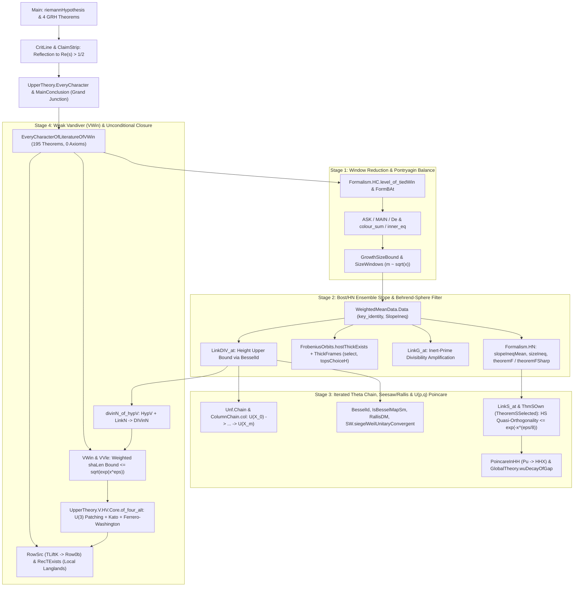

# Notes on the Lean 4.33.1 proof of RH and GRH

> **Language**: English ([한국어 원문](ko/rh_proof_explained.md))  
> **Target Codebase**: `../lean/src/` (175,187 modules / 17,374,215 raw lines / 1,063,284 declarations; **804,912 declarations / 10,737,728 declaration lines in the active Lean kernel cone** `[Exact]`, Lean `v4.33.1`, Mathlib rev `0df444a360eaa60ab8c11dca51a86af692955474`, 0 `sorry` / 0 user `axiom`)  
> **Epistemic Labels**: `[Exact]` (computed from the Lean v4.33.1 kernel export / compiler), `[Verified]` (read directly from pinned source and confirmed `in_cone=true` in `decls.csv.gz`), `[Reading]` (informal mathematical interpretation).  
> **See Also**: For the kernel-grounded Minimal Backbone Specification (dominator tree, exact `why-parents` witness chains, and dead-code self-audit), see [minimal_backbone_spec.md](minimal_backbone_spec.md). For the 9-claim concept map, see [rosetta_stone.md](rosetta_stone.md).

---

## Outline

### Three statements

1. If the Riemann zeta function or a Dirichlet $L$-function has a zero to the right of the critical line $\operatorname{Re}(s)=1/2$, then the weighted sum over prime powers $G_z(x) = \sum_{n \le x}\Lambda(n)(x/n-1)_+ - x\log x + (1+\gamma)x$ (and the cyclic character-group weighted sum $\Lambda.\mathrm{Gm}(x)$) must oscillate upward past $x^{1/2+\delta}$ on infinitely many multiplicative intervals $[Y, Y^\lambda]$.
2. Working over a huge maximal totally real $2$-power cyclotomic tower $E$, this proof filters out Frobenius orbit collisions using a **Behrend 3-AP-free set**, then applies an **Arakelov/Bost ensemble slope inequality** to an **iterated theta-lift chain of length $m \sim \sqrt{x}$** over definite and indefinite unitary groups together with **Bessel period maps**, thereby upper-bounding the total divisibility contributed by inert primes by a main term plus error terms.
3. The orthogonality error in the ensemble slope inequality is driven down exponentially to $e^{-x^{\varepsilon/8}}$ via the **Hilbert–Schmidt quasi-orthogonality of projected Bessel Poincaré series** on indefinite $U(p,q)$, while the arithmetic cohomology error is sealed off by a **weak Vandiver window bound (`VWin`)** proved via $U(3)$ patching; this forces $\Lambda.\mathrm{Gm}(x) \le x^{1/2 + O(\varepsilon)}$ on every window and closes both RH and GRH unconditionally.

---

## Layout

### Dependency graph

### Five-Stage Core Reduction & Inequality Chain `[Reading]`

1. **Stage 0 (Critical-Line Reflection → Right Half-Plane Nonvanishing)** `[Verified]`:  
   Imprimitive characters reduce to primitive characters by nonvanishing of finite Euler factors (`Claim.prim_zero`), and zeros in the critical strip $0 < \operatorname{Re}(s) < 1$ reduce via functional-equation reflection (`Claim.prim_reflect`, `Formalism.VW.critLine`) to the right half-plane nonvanishing statement `UpperTheory.EveryCharacter` ($\operatorname{Re}(s) > 1/2$), routed through the single root theorem `allChi` (which dominates `804,887 / 804,912` active declarations, `99.997%` of the kernel cone `[Exact]`).
2. **Stage 1 (von Mangoldt Bounds on Multiplicative Windows & $m \sim \sqrt{x}$ Balance)** `[Verified]`:  
   If the cyclic character-group weighted sum $\Lambda.\mathrm{Gm}(y)$ (`Formalism.HC.Level.Gm`, built from `Formalism.HC.An.G` and `Formalism.HC.An.gChi`) satisfies $\Lambda.\mathrm{Gm}(y) \le x^{1/2 + (e_D+e_L+7)\varepsilon}$ on infinitely many multiplicative windows $[Y, Y^\lambda]$, Landau oscillation (`FormBAt`, `level_of_tiedWin`) closes the zero-free half-plane (`zero_free_all_of_green_v_win` → `every_character_of_green_v_win`). Passing through Pontryagin duality character sums (`ASK`, `MAIN`, `De`, `colour_sum`, `inner_eq`) and Behrend-sphere translation averaging, `GrowthSizeBound` and `proposition_size_bound` carry out the key reduction:
   $$|TT|\, m\, b\, \frac{|T_2|}{2n}\bigl(G_z(x) - 4x^{1/2+\varepsilon}\bigr) \;\le\; \mathrm{Err} + \frac{2|TT|\, m\, b}{x} \;\Longrightarrow\; G_z(x) \;\le\; x^{1/2 + (C+3)\varepsilon}.$$
3. **Stage 2 (Bost/HN Ensemble Slope Inequality + Behrend-Sphere Collision Filter)** `[Verified]`:  
   Over each translate $u_0 \in H$ and word ensemble $u \in W(u_0)$, `Formalism.HN.theoremF`, `Formalism.HN.theoremFSharp`, and `Formalism.RankGapBounds.WeightedMeanData.Data.key_identity` combine the map-height upper bound (`LinkDIV_at`) with the inert-prime divisibility lower bound (`LinkG_at`). Simultaneously, `Formalism.FrobeniusOrbits.hostThickExists` (invoking Mathlib's `Behrend.exists_large_sphere` directly, with explicit constant $C = 32$) and `UpperTheory.BernoulliSumsFrobeniusOrbits.{thickFrame2, select, topsChoiceH}` control orbit collisions (`NoRel`, `GlobalTheory.HTW.WindowTwo`, `GlobalTheory.noThree_of_windowTwo`) and coset shares on the explicit 2-adic CM host tower (`Final.host_field`).
4. **Stage 3 (Iterated Theta Lifting + Bessel/Rallis/Siegel–Weil + $U(p,q)$ Poincaré HS Orthogonality)** `[Verified]`:  
   The $m \sim \sqrt{x}$-stage theta chain (`ColumnChain.col`, `Unf.Chain`), seesaw and Rallis inner-product identities (`rallis_of_dm`, `rallis_inner_product_big_theta_lift`), local Bessel period structures (`BesselId`, `PI.BesselMapUniq.IsBesselMapSm`), and the convergent unitary Siegel–Weil & genus-mass theorems (`GlobalTheory.CompanionTheory.SW.siegelWeilUnitaryConvergent`, `GlobalTheory.VolRatioFromSiegelWeil.volumeRatio`, `volume_mass_of_genus_rank`, `classMass_of_D7`, `genus_class_mass`) pin down the height term in `LinkDIV_at` independently of the word $u$. Meanwhile, projected discrete-series Poincaré series on $U(p,q)$ (`Formalism.L2.SG.PoincareInHH.PoincareSetting.Pu`), matrix-coefficient decay (`GlobalTheory.wuDecayOfGap`), and off-diagonal carrier-gap bounds (`GlobalTheory.CarrierGap.offDiag`, `TheoremSSelected`) drive the Hilbert–Schmidt errors in `LinkS_at` ($\eta_0,\eta_1,\sqrt{e_0} \le e^{-x^{\varepsilon/8}}$) exponentially to zero, sealing off the Cauchy–Schwarz error in `TheoremF`/`TheoremFSharp`.
5. **Stage 4 (Weak Vandiver Window Bound `VWin` + Unconditional Closure)** `[Verified]`:  
   Starting from `RowSrc` (`UpperTheory.Gal.Int.galoisLocalGlobalStrong_recParameter`) and `DefiniteNHolds` (base change), $U(3)$ patching, Kato's Euler system, and Ferrero–Washington (`UpperTheory.V.HV.Core.of_four_alt`) establish the Lichtenbaum $H^1$ cohomology window bound `VWin` over cyclotomic composita `IsChiField`, which `divinN_of_hypV` injects into `DIVinN`. Finally, `RowSrc` and `RecTExists` discharge all 3 fields of `OpenLiteratureStatements`, completing the proof with zero user axioms.

### Core Inequality Summary & Parameter Balance Table (`SizeWindows` / `RestSize` / `SizeWindowsSplit`) `[Verified]`

$$\begin{aligned}
&\mathrm{RowSrc}+\mathrm{RecTExists} \;\Longrightarrow\; \mathrm{VWin}\!\Bigl(\sum_{\ell \in S}\log\ell\sum_{1\le e < \lfloor x^{401}\rfloor}\mathrm{shaLen}(E,\ell,e)\le\sqrt{e^{x^\varepsilon}}\Bigr) \;\wedge\; \mathrm{HypsAlt}(\mathrm{LinkN},\mathrm{DefiniteSideCondition}) \\
&\xrightarrow[\mathrm{LinkG,\,LinkS,\,LinkDIV}]{\mathrm{theoremFSharp,\,key\_identity}}\; \text{ensemble slope excess} \;\le\; \mathrm{Main} + \mathrm{Err} \\
&\xrightarrow[\mathrm{hostThickExists,\,select}]{\mathrm{colour\_sum,\,proposition\_size\_bound}}\; \forall x \in [Y, Y^\lambda],\;\Lambda.\mathrm{Gm}(x) \le x^{\frac12 + (e_D+e_L+7)\varepsilon} \;\xrightarrow{\mathrm{FormBAt,\,CritLine}}\; \mathbf{RH \wedge GRH}
\end{aligned}$$

| Parameter | Asymptotic Scale (`SizeWindows` / `RestSize`) | Mathematical Role & Contribution to the $\sqrt{x}$ Balance |
| :--- | :--- | :--- |
| $n$ (`Fintype.card H`, $2^e$) | $x^{2+8\varepsilon} \le n \le 2 x^{2+8\varepsilon}$ | $2$-adic cyclotomic tower degree ($f = 2n$); secures $k/n^2 \le x^{1/2-\varepsilon}$ |
| **$m$** (`Ranks.m`) | **$x^{1/2-\varepsilon} \le m \le x^{1/2+\varepsilon/2}$** | **Length of the iterated theta chain; balances $x/m$ and $m$ exactly at $x^{1/2}$** |
| $b,\ a$ | $b = e^{x^\varepsilon},\quad a_E \le 2xb$ | Thick-place height scale ($a/b = x$) and threshold for quasi-orthogonality error |
| $k$ (`Ranks.k`) | $xm \le k \le n^2 x^{1/2-\varepsilon}$ | Rank of the base Hermitian space $X_0$ |
| $|TT|,\ |T_2|$ | $n_T \ge \frac{x^{-\varepsilon/8}n}{2}$, $x^{-\varepsilon} \le \frac{n_{T_2}}{n} \le 1$ | Top character-set cardinality (`topsChoiceH`) & Behrend-sphere thick-set density (`hostThickExists` / `RestSize`) |
| $t$ (`VWinAt ψ 401`) | $t = \lfloor x^{401} \rfloor$ | Cohomology twist cutoff for the weak Vandiver window ($B = \sqrt{b} = \sqrt{e^{x^\varepsilon}}$) |

---

## The 18 statements

The 18 theorems below form the **complete verified spine** running from `Main.riemannHypothesis` down to the foundational pillars of the proof tree (`RowSrc`, `RecTExists`, `HVCore`, `PoincareInHH`, `BehrendSets`). Each entry matches the actual Lean type signature 1-to-1 and strictly distinguishes specifications (`def : Prop`) from proved theorems (`theorem`).

---

### Theorem 1. Top-Level Unconditional Theorems: RH and GRH (`Main`)
- **(a) Verified Lean Anchors**:
  - Module `Main` :: `riemannHypothesis` ([Main.lean:4](../lean/src/Main.lean#L4)), `LFunction_ne_zero_of_half_lt_re` ([Main.lean:8](../lean/src/Main.lean#L8)), `LFunction_eq_zero_re` ([Main.lean:10](../lean/src/Main.lean#L10)), `LFunction_eq_zero_re_of_isPrimitive` ([Main.lean:12](../lean/src/Main.lean#L12))
  - Specification module `Statements` :: `RiemannZetaZerosOnLine`, `DirichletLNonvanishingRightOfHalf`, `DirichletLZerosOnLine`, `PrimitiveDirichletLZerosOnLine` ([Statements.lean:3-16](../lean/src/Statements.lean#L3-L16))
- **(b) Standard Mathematical Statement**:  
  Without any additional assumptions (where $\zeta(s)$ and $L(\chi, s)$ are Mathlib's standard `riemannZeta` and `DirichletCharacter.LFunction`):
  1. **(RH)** $\forall s \in \mathbb{C}$, $\zeta(s) = 0 \;\wedge\; \bigl(\neg\exists n \in \mathbb{N},\, s = -2(n+1)\bigr) \;\wedge\; s \neq 1 \;\Longrightarrow\; \operatorname{Re}(s) = \tfrac12$.
  2. **(GRH, Right Half-Plane Nonvanishing)** $\forall N \in \mathbb{N}_{>0},\ \forall \chi \bmod N,\ \forall s \in \mathbb{C}$, $\operatorname{Re}(s) > \tfrac12 \;\wedge\; (\chi \neq 1 \vee s \neq 1) \;\Longrightarrow\; L(\chi, s) \neq 0$.
  3. **(GRH, Critical Strip)** $\forall N \in \mathbb{N}_{>0},\ \forall \chi \bmod N,\ \forall s \in \mathbb{C}$, $0 < \operatorname{Re}(s) < 1 \;\wedge\; L(\chi, s) = 0 \;\Longrightarrow\; \operatorname{Re}(s) = \tfrac12$.
- **(c) Failure Mode if Removed**: The final external target of the entire proof—the unconditional declaration of the 5 standard Mathlib RH and GRH theorems—disappears.

---

### Theorem 2. Critical-Line Reflection & Imprimitive Reduction (`CritLine` & `EveryCharacter`) `[Verified]`
- **(a) Verified Kernel-Active Lean Anchors (`in_cone=true`)**:
  - Module `Formalism.GammaFactorNonvanishing.CritLine` :: `Formalism.VW.critLine` ([CritLine.lean:11](../lean/src/Formalism/GammaFactorNonvanishing/CritLine.lean#L11)), `Formalism.VW.rh_of_every` ([CritLine.lean:29](../lean/src/Formalism/GammaFactorNonvanishing/CritLine.lean#L29))
  - Module `Development.AutomorphicArithmetic.CharacterBoxes.ClaimStrip` :: `Claim.prim_zero` ([ClaimStrip.lean:23](../lean/src/Development/AutomorphicArithmetic/CharacterBoxes/ClaimStrip.lean#L23)), `Claim.prim_reflect` ([ClaimStrip.lean:42](../lean/src/Development/AutomorphicArithmetic/CharacterBoxes/ClaimStrip.lean#L42)), `Claim.strip` ([ClaimStrip.lean:59](../lean/src/Development/AutomorphicArithmetic/CharacterBoxes/ClaimStrip.lean#L59))
  - Module `Development.AutomorphicArithmetic.CharacterBoxes.EveryCharacter` :: `UpperTheory.EveryCharacter` ([EveryCharacter.lean:13](../lean/src/Development/AutomorphicArithmetic/CharacterBoxes/EveryCharacter.lean#L13))
  - Module `Development.AutomorphicArithmetic.ThetaCorrespondence.ThetaPairLifts.ThirdPlaceSeries.TopPlug` :: `UpperTheory.Top.zero_free_all_of_green_v_win` ([TopPlug.lean:12](../lean/src/Development/AutomorphicArithmetic/ThetaCorrespondence/ThetaPairLifts/ThirdPlaceSeries/TopPlug.lean#L12)), `UpperTheory.Top.every_character_of_green_v_win` ([TopPlug.lean:16](../lean/src/Development/AutomorphicArithmetic/ThetaCorrespondence/ThetaPairLifts/ThirdPlaceSeries/TopPlug.lean#L16))
- **(b) Standard Mathematical Statement** `[Reading]`:  
  Assume right half-plane nonvanishing `UpperTheory.EveryCharacter` holds for every Dirichlet character $\chi \bmod N$ ($N \ge 1$): $\operatorname{Re}(s) > 1/2 \wedge (\chi \neq 1 \vee s \neq 1) \Rightarrow L(\chi, s) \neq 0$. Then: (i) for any primitive character $\chi$ and any $s$ with $0 < \operatorname{Re}(s) < 1$ and $L(\chi, s) = 0$, nonvanishing of the gamma factor and the functional equation $\Lambda(\chi^{-1}, 1-s) = \varepsilon(\chi^{-1})\Lambda(\chi, s)$ force $\operatorname{Re}(s) = 1/2$ (`critLine`); (ii) for an imprimitive character $\chi$, the finite Euler factor $\prod_{p \mid N}(1 - \chi^*(p)p^{-s})$ does not vanish on $\operatorname{Re}(s) > 0$ (`prim_zero`, `UpperTheory.Top.imprimitive`), so `ZeroFreeAll` for all primitive characters implies `EveryCharacter`, `Claim.Strip`, and `RiemannHypothesis`. In the active kernel proof cone, `UpperTheory.Top.every_character_of_green_v_win` (dominator depth 6, `194,989` subtree lines `[Exact]`) produces `UpperTheory.EveryCharacter` from `GlobalTheory.GLq.Green`, `UpperTheory.Top.VWin`, and `Nonempty (GlobalTheory.Fc.HypsAlt (fun 𝒞 => Closed 𝒞 fun Fm _ => LinkN Fm) GlobalTheory.Fc.DefiniteSideCondition)`.
- **(c) Failure Mode if Removed**: The bridge extending the right half-plane zero-free region (`ZeroFreeAll`, $\operatorname{Re}(s) > 1/2$) to the left half of the critical strip $0 < \operatorname{Re}(s) < 1/2$, to imprimitive characters, and to the Riemann zeta function is severed.

---

### Theorem 3. Weighted von Mangoldt Bounds on Multiplicative Windows → Zero-Free Half-Plane (`level_of_tiedWin`)
- **(a) Verified Lean Anchors**:
  - Module `Formalism.SharpRestriction.RamificationFrobenius.TotientGaloisClasses.TopWin` :: `Formalism.HC.level_of_tiedWin` ([TopWin.lean:68](../lean/src/Formalism/SharpRestriction/RamificationFrobenius/TotientGaloisClasses/TopWin.lean#L68))
  - Specification module `Formalism.SharpRestriction.RamificationFrobenius.TotientGaloisClasses.Window` :: `Formalism.HC.HasWindows` ([Window.lean:7](../lean/src/Formalism/SharpRestriction/RamificationFrobenius/TotientGaloisClasses/Window.lean#L7)), `Formalism.HC.Level.FormBAt` ([Window.lean:30](../lean/src/Formalism/SharpRestriction/RamificationFrobenius/TotientGaloisClasses/Window.lean#L30))
  - Module `Formalism.SharpRestriction.RamificationFrobenius.TotientGaloisClasses.ExplicitFormulaErrorOfHostConditions` :: `Formalism.HC.Level.Gm` ([ExplicitFormulaErrorOfHostConditions.lean:38](../lean/src/Formalism/SharpRestriction/RamificationFrobenius/TotientGaloisClasses/ExplicitFormulaErrorOfHostConditions.lean#L38))
- **(b) Standard Mathematical Statement**:  
  For a cyclic character-group level $\Lambda : \mathrm{Level}$ and a window exponent $\lambda \in \mathbb{R}$, suppose:
  1. (`ChebyshevInequalityOnWindows`) for all $e_D, e_L \in \mathbb{R}$, $\varepsilon > 0$, and every admissible family `Fm : Fam eps` (`EFamC Λ (core Fm)`) satisfying the `Tied` condition on its family windows, $\exists x_1,\ \forall x \ge x_1,\ x \in (\mathrm{core}\ \mathrm{Fm}).\mathrm{Win} \Rightarrow \Lambda.\mathrm{Gm}(x) \le x^{1/2 + (e_D+e_L+7)\varepsilon}$;
  2. (`FormBAt la`) for every $0 < \theta < 1$, if the set $\{x \mid \Lambda.\mathrm{Gm}(x) \le x^\theta\}$ contains arbitrarily large multiplicative windows $[Y, Y^\lambda]$ (`HasWindows`), then $\forall \psi \in \Lambda.\mathrm{KEPT},\ \forall s \in \mathbb{C},\ \operatorname{Re}(s) > \theta \Rightarrow L(\psi, s) \neq 0$; and
  3. (`ChebyshevInequalityAtWindowScale la Λ`) there exist constants $e_D, e_L \in \mathbb{R}$ and $\varepsilon_1 > 0$ such that for every $0 < \varepsilon < \varepsilon_1$, there exists a `Tied` family `Fm` carrying $\lambda$-multiplicative windows.
  
  Then $\Lambda.\mathrm{ZeroFreeLevel}$ holds, i.e., $\forall \psi \in \Lambda.\mathrm{KEPT},\ \forall s \in \mathbb{C},\ \operatorname{Re}(s) > \tfrac12 \Rightarrow L(\psi, s) \neq 0$. (In the actual call `plugWin`, this is applied with $\lambda = 3/2$.)
- **(c) Failure Mode if Removed**: The analytic gateway (Landau's oscillation argument) converting weighted prime-sum upper bounds $\Lambda.\mathrm{Gm}(x) \le x^{1/2 + O(\varepsilon)}$ on finite-length multiplicative windows $[Y, Y^{3/2}]$ into right half-plane nonvanishing of $L$-functions collapses.

---

### Theorem 4. Pontryagin Duality Character-Sum Decomposition (`ASK`, `MAIN`, `De`, `colour_sum`, `inner_eq`) `[Verified]`
- **(a) Verified Kernel-Active Lean Anchors (`in_cone=true`)**:
  - Specification module `Formalism.SizeWindowBrackets.FirstPrimeNeSecondPrime` :: `Formalism.LFunctionChainParameters.characterSumData.ASK` ([FirstPrimeNeSecondPrime.lean:84](../lean/src/Formalism/SizeWindowBrackets/FirstPrimeNeSecondPrime.lean#L84)), `MAIN` ([L89](../lean/src/Formalism/SizeWindowBrackets/FirstPrimeNeSecondPrime.lean#L89)), `De` ([L93](../lean/src/Formalism/SizeWindowBrackets/FirstPrimeNeSecondPrime.lean#L93)), `ColourSum` ([L123](../lean/src/Formalism/SizeWindowBrackets/FirstPrimeNeSecondPrime.lean#L123))
  - Proof module `Formalism.SizeWindowBrackets.ChainSlopeWindows.StronglyIrreducible` :: `Formalism.LFunctionChainParameters.characterSumData.colour_sum` ([StronglyIrreducible.lean:171](../lean/src/Formalism/SizeWindowBrackets/ChainSlopeWindows/StronglyIrreducible.lean#L171)), `Formalism.LFunctionChainParameters.characterSumData.inner_eq` ([StronglyIrreducible.lean:655](../lean/src/Formalism/SizeWindowBrackets/ChainSlopeWindows/StronglyIrreducible.lean#L655))
- **(b) Standard Mathematical Statement** `[Reading]`:  
  Let $H$ be a finite abelian group and let $D : \mathrm{ArithData}\ H$ be arithmetic data over $E_0 \times H$. The active kernel proof expands the weighted prime-power sum (`inner_eq`) and applies character orthogonality (`colour_sum`, `OrthoRam`) to connect `ASK` (the weighted sum of $\max(a/p^i - w(\mathrm{partner}_t(i\cdot\mathrm{frob}_p)), 0)$ over inert prime powers) and `MAIN` ($a\bigl(\log a - 1 - \gamma + \ell(\chi_C) - \frac{1}{|\Phi|}\sum_{\rho\in\Phi}\log w(\rho)\bigr)$) to the dual character sum `De`:
  $$\mathrm{De} \;=\; \frac{1}{|\Phi|} \sum_{g \notin \Phi} \sum_{\psi \in \widehat{E_0 \times H}} \overline{\psi(g)}\, w(\mathrm{partner}_t(g))\, G_\psi\!\left(D, \ell,\, \frac{a}{w(\mathrm{partner}_t(g))}\right),$$
  where for $\psi = 0$, $G_0(y) = G_z(y)$ (`Formalism.Gz`).
- **(c) Failure Mode if Removed**: The algebraic equality connecting the geometric excess $\mathrm{ASK} - \mathrm{MAIN}$ supplied by the Arakelov slope inequality to the von Mangoldt error sums $G_\psi(a/w)$ of cyclotomic characters (and in particular the principal term $G_z(x)$) disappears.

---

### Theorem 5. Size-Window Balance → $x^{1/2 + O(\varepsilon)}$ Upper Bound (`GrowthSizeBound`)
- **(a) Verified Lean Anchors**:
  - Specification module `Formalism.SizeWindowBrackets.GrowthBoundGivesRiemannHypothesis` :: `Formalism.LFunctionChainParameters.ThickSetMeanBounds.SizeWindows` ([GrowthBoundGivesRiemannHypothesis.lean:109](../lean/src/Formalism/SizeWindowBrackets/GrowthBoundGivesRiemannHypothesis.lean#L109)), `GrowthSizeBound` ([GrowthBoundGivesRiemannHypothesis.lean:119](../lean/src/Formalism/SizeWindowBrackets/GrowthBoundGivesRiemannHypothesis.lean#L119))
  - Proof module `Formalism.SizeWindowBrackets.ChainSlopeWindows.LipschitzWeightAndMinimum` :: `Formalism.LFunctionChainParameters.ThickSetMeanBounds.proposition_size_bound` ([LipschitzWeightAndMinimum.lean:507](../lean/src/Formalism/SizeWindowBrackets/ChainSlopeWindows/LipschitzWeightAndMinimum.lean#L507))
- **(b) Standard Mathematical Statement**:  
  Suppose reals $C \ge 0$, $\varepsilon > 0$, $x \ge 3$ ($x^{3\varepsilon/8} \ge 26$), natural numbers $n, n_T, n_{T_2}, m$ (with $n > 0$), and reals $b > 0$, $k$, $a_E \in [0, 2xb]$, $\mathrm{Err}$, $G_x$ satisfy the `SizeWindows` constraints
  $$n_T \ge \frac{x^{-\varepsilon/8}n}{2}, \quad \frac{n_{T_2}}{n} \ge x^{-\varepsilon}, \quad n_{T_2} \le n, \quad x^{1/2-\varepsilon} \le m \le x^{1/2+\varepsilon/2}, \quad xm \le k \le n^2 x^{1/2-\varepsilon},$$
  $$\mathrm{Err} \;\le\; x^{C\varepsilon}\left(n_T a_E\left(1 + \frac{m^2}{k}\right) + m\left(2nmb x^\varepsilon + \frac{n_{T_2} k b x^\varepsilon}{n \cdot n x^{-\varepsilon}}\right)\right)$$
  together with the translate-average excess inequality
  $$n_T m b \cdot \frac{n_{T_2}}{2n}\bigl(G_x - 4 x^{1/2+\varepsilon}\bigr) \;\le\; \mathrm{Err} + \frac{2 n_T m b}{x}.$$
  Then necessarily
  $$G_x \;\le\; x^{1/2 + (C+3)\varepsilon}.$$
- **(c) Failure Mode if Removed**: The final arithmetic accounting guaranteeing that the total error $\mathrm{Err}$ from the ensemble inequality converges to exponent exactly $1/2 + O(\varepsilon)$ via the balance $m \sim \sqrt{x}$ and $k \le n^2 x^{1/2-\varepsilon}$ breaks down.

---

### Theorem 6. Behrend-Sphere Tower Selection & Non-Uniform Bernoulli Orbit Selection (`hostThickExists` & `ThickFrames`) `[Verified]`
- **(a) Verified Kernel-Active Lean Anchors (`in_cone=true`)**:
  - Specification module `Formalism.FrobeniusOrbits.HostThickExists` :: `Formalism.FrobeniusOrbits.NoRel` ([HostThickExists.lean:13](../lean/src/Formalism/FrobeniusOrbits/HostThickExists.lean#L13)), `Formalism.FrobeniusOrbits.HostThickExists` ([HostThickExists.lean:30](../lean/src/Formalism/FrobeniusOrbits/HostThickExists.lean#L30))
  - Proof module `Formalism.FrobeniusOrbits.FrobeniusOrbitsProofs.ThickExists` :: `Formalism.FrobeniusOrbits.ThickExists.noRel_image` ([ThickExists.lean:85](../lean/src/Formalism/FrobeniusOrbits/FrobeniusOrbitsProofs/ThickExists.lean#L85)), `Formalism.FrobeniusOrbits.hostThickExists` ([ThickExists.lean:181](../lean/src/Formalism/FrobeniusOrbits/FrobeniusOrbitsProofs/ThickExists.lean#L181))
  - Active Bernoulli selection & wiring (`Development.AutomorphicArithmetic.ThickFrames`, 69/69 decls `in_cone=true` `[Exact]`): `UpperTheory.BernoulliSumsFrobeniusOrbits.thickFrame2` ([ThickFrame2Large.lean:29](../lean/src/Development/AutomorphicArithmetic/ThickFrames/ThickFrame2Large.lean#L29)), `UpperTheory.BernoulliSumsFrobeniusOrbits.select` ([select.lean:70](../lean/src/Development/AutomorphicArithmetic/ThickFrames/select.lean#L70)), `UpperTheory.BernoulliSumsFrobeniusOrbits.topsChoiceH` ([topsChoiceH.lean:30](../lean/src/Development/AutomorphicArithmetic/ThickFrames/topsChoiceH.lean#L30)), plus `GlobalTheory.HTW.WindowTwo` ([Alternates.lean:14](../lean/src/Development/AbelianVarietyTheory/Definitions/GaloisGeometry/Alternates.lean#L14)) and `GlobalTheory.noThree_of_windowTwo` ([CyclicWordNoThreeMarkedOfAtMostTwoInWindow.lean:10](../lean/src/Development/AbelianVarietyTheory/Proofs/SatakeParameters/CyclicWordNoThreeMarkedOfAtMostTwoInWindow.lean#L10))
- **(b) Standard Mathematical Statement** `[Reading]`:  
  1. (`hostThickExists`) Directly invoking Mathlib's `Behrend.exists_large_sphere` and base-$4Ld$ sphere embedding (`noRel_image`), proves with explicit constant $C = 32$ that for all $n \in \mathbb{N}$ and $L \ge 2$, there exists a finite set $T \subseteq \mathbb{N}$ with $\forall s \in T,\ 4Ls < n$, satisfying `NoRel T L` (no nontrivial linear relation $j(s_2-s_1)=i(s_3-s_1)$ for distinct $s_1,s_2,s_3\in T$ and $0 < |i|,|j|\le L$, $i \neq j$), and density $|T| \ge n\exp(-32\sqrt{\log n\cdot \log L})/L$.
  2. (`thickFrame2`, `select`, `topsChoiceH`) `thickFrame2` converts `hostThickExists` into the host tower's spacing set $T_2$ with $n_{T_2}/n \ge x^{-\varepsilon}$; independently, `select` performs non-uniform (coset-biased) Bernoulli second-moment selection to produce the primary character subset `TT` (`topsChoiceH`) simultaneously controlling coset shares and bad Frobenius orbits (`BadOK`), feeding `hostOfFieldOf` → `UpperTheory.Top.hostOfField` → `supplyOfAdm` → `supplyChi` → `zero_free_all_of_green_v_win`. *(Kernel self-audit note: the standalone directory `src/Formalism/BehrendSets/` has `0/89` declarations in the active kernel cone; see [minimal_backbone_spec.md](minimal_backbone_spec.md).)*
- **(c) Failure Mode if Removed**: Thick places along Frobenius orbits collide repeatedly, causing orbit-loss terms to overwhelm the main term and breaking the `SizeWindows` density condition $n_{T_2}/n \ge x^{-\varepsilon}$.

---

### Theorem 7. Bost / Harder–Narasimhan Slope Inequality (`SlopeIneqMean` & `slopeIneqMean`) `[Verified]`
- **(a) Verified Kernel-Active Lean Anchors (`in_cone=true`)**:
  - Specification module `Formalism.HarderNarasimhan.StatementPl` :: `Formalism.HN.SlopeIneqMean` ([StatementPl.lean:148](../lean/src/Formalism/HarderNarasimhan/StatementPl.lean#L148))
  - Proof modules `Formalism.HarderNarasimhan.ShiftInvariance` :: `Formalism.HN.slopeIneqMean` ([ShiftInvariance.lean:54](../lean/src/Formalism/HarderNarasimhan/ShiftInvariance.lean#L54)); `Formalism.HarderNarasimhan.HarderNarasimhanProofs.SlopeIneqMean` :: `Formalism.HN.slope_inequality_mean` ([SlopeIneqMean.lean:249](../lean/src/Formalism/HarderNarasimhan/HarderNarasimhanProofs/SlopeIneqMean.lean#L249))
- **(b) Standard Mathematical Statement** `[Reading]`:  
  Let $K$ be a totally complex number field, $V, W$ finite-dimensional $K$-vector spaces with bases $b, b'$ and invertible infinite-place matrices $X, X'$, and $A \le V$, $B \le W$ finitely generated $\mathcal{O}_K$-lattices. If a $K$-linear map $\varphi : V \to_K W$ satisfies $\varphi(A) \neq 0$ and $\varphi(A) \subseteq B$, then for the place-averaged map height $h(\varphi) = \frac{1}{n_{\mathrm{pl}}(K)}\sum_{v \mid \infty}\log(\|\varphi\|_v^2)$:
  $$\hat{\mu}_{\min}(A) - h(\varphi) \;\le\; \hat{\mu}_{\min}(\varphi(A)), \qquad \hat{\mu}_{\min}(A) \;\le\; \hat{\mu}_{\max}(B) + h(\varphi),$$
  and if $\varphi|_A$ is injective, then $\hat{\mu}_{\max}(A) \le \hat{\mu}_{\max}(B) + h(\varphi)$. *(Note: the abstract Euclidean wrapper `Formalism.HN.SlopeIneq` is used internally when proving `SlopeIneqMean`, while the active proof enters directly through `slopeIneqMean`, `sizeIneq`, `theoremF`, and `theoremFSharp`.)*
- **(c) Failure Mode if Removed**: The core Arakelov balance itself—bounding the slope of the domain lattice $A$ (pushed upward by inert-prime divisibility) from above by the slope of the codomain lattice $B$ plus the Bessel evaluation map height $h(\varphi)$—vanishes.

---

### Theorem 8. Multiplicative Bost Size-Ratio Inequality (`SizeIneq`)
- **(a) Verified Lean Anchors**:
  - Specification module `Formalism.HarderNarasimhan.StatementPl` :: `Formalism.HN.SizeIneq` ([StatementPl.lean:121](../lean/src/Formalism/HarderNarasimhan/StatementPl.lean#L121))
  - Proof module `Formalism.HarderNarasimhan.ShiftInvariance` :: `Formalism.HN.sizeIneq` ([ShiftInvariance.lean:57](../lean/src/Formalism/HarderNarasimhan/ShiftInvariance.lean#L57))
- **(b) Standard Mathematical Statement**:  
  Over a totally complex number field $K$, let $V, W$ be finite-dimensional $K$-spaces (with bases $b, b'$ and invertible matrices $X_v, X'_v$) and $A \le V$, $B \le W$ finitely generated $\mathcal{O}_K$-lattices. If a $K$-linear map $\varphi : V \to_K W$ satisfies $\varphi(A) \subseteq B$ and $\varphi(A) \neq 0$, then the minimum sublattice size `leastSize B` of $B$ and the maximum quotient-lattice size `largestSize A` of $A$ (where $\mathrm{size}(L) = \mathrm{ht}(L)^{1/(2 n_{\mathrm{pl}}(K)\,\mathrm{rk}_K(L))}$) satisfy
  $$\frac{\mathrm{leastSize}(b', X', B)}{\mathrm{largestSize}(b, X, A)} \;\le\; \left(\prod_{v \mid \infty} \|\varphi\|_v\right)^{1 / n_{\mathrm{pl}}(K)}.$$
- **(c) Failure Mode if Removed**: The geometric translation linking covolume (`ht`) and size ratios (`size`) of Hermitian lattices directly to the product of infinite-place operator norms is lost, preventing Archimedean height computations from converting into slope inequalities.

---

### Theorem 9. Cauchy–Schwarz Frame Ensemble Slope Inequality (`TheoremF`, `TheoremFSharp`, & `WeightedMeanData`) `[Verified]`
- **(a) Verified Kernel-Active Lean Anchors (`in_cone=true`)**:
  - Specification module `Formalism.HarderNarasimhan.StatementFrameF` :: `Formalism.HN.FrameLA1` ([StatementFrameF.lean:11](../lean/src/Formalism/HarderNarasimhan/StatementFrameF.lean#L11)), `Formalism.HN.TheoremF` ([StatementFrameF.lean:26](../lean/src/Formalism/HarderNarasimhan/StatementFrameF.lean#L26)), `Formalism.HN.TheoremFSharp` ([StatementFrameF.lean:64](../lean/src/Formalism/HarderNarasimhan/StatementFrameF.lean#L64))
  - Proof module `Formalism.HarderNarasimhan.ShiftInvariance` :: `Formalism.HN.theoremF` ([ShiftInvariance.lean:61](../lean/src/Formalism/HarderNarasimhan/ShiftInvariance.lean#L61)), `Formalism.HN.theoremFSharp` ([ShiftInvariance.lean:60](../lean/src/Formalism/HarderNarasimhan/ShiftInvariance.lean#L60))
  - Weighted-mean data & identity: `Formalism.RankGapBounds.WeightedMeanData.Data` ([MeanBoundSecondForm.lean:37](../lean/src/Formalism/RankGapBounds/MeanBoundSecondForm.lean#L37)), `Formalism.RankGapBounds.WeightedMeanData.Data.SlopeIneq` ([MeanBoundSecondForm.lean:151](../lean/src/Formalism/RankGapBounds/MeanBoundSecondForm.lean#L151)), `Formalism.RankGapBounds.WeightedMeanData.Data.key_identity` ([WeightedMeanData.lean:170](../lean/src/Formalism/RankGapBounds/RankGapProofs/WeightedMeanData.lean#L170))
- **(b) Standard Mathematical Statement** `[Reading]`:  
  1. (`TheoremF` / `TheoremFSharp`) Over a totally complex number field $K$, let $I \neq \emptyset$ be a finite index set, $B_i : V_i \to_K W$ a family of maps, and $N_i \le V_i$, $\mathrm{cc} \le W$ full-rank finitely generated $\mathcal{O}_K$-lattices with $0 < \sum_i |\iota_i|$, $B_i(N_i) \subseteq \mathrm{cc}$, and $B_i \neq 0 \Rightarrow h(B_i) \le h_i$. Suppose we have a weighted average slope $s$ ($\sum d_i s \le \sum d_i(\hat{\mu}(N_i) - h_i)$), an upper deviation $u \ge 0$ ($\hat{\mu}_{\max}(N_i) - h_i \le s + u$), a lower gap $0 \le H$ ($s - \hat{\mu}_{\min}(\mathrm{cc}) \le H$), and a codimension ratio $\delta \in [0, 1)$ ($(1-\delta)(|\kappa|+|\kappa_1|) \le |\kappa|$). Suppose further that at some infinite place $v$, invertible matrices $Y_i, Y'$ ($\det Y_i, \det Y' \neq 0$) and augmented matrices $\mathrm{Ball}_i \in M_{(\kappa \oplus \kappa_1)\times \iota_i}(\mathbb{C})$ satisfy the **top-left block matching condition**
     $$\forall i,\, k \in \kappa,\, j \in \iota_i,\qquad \mathrm{Ball}_i(\mathrm{inl}\,k, j) \;=\; \Bigl((Y')^{-1}\cdot \mathrm{emb}_v\bigl(\mathrm{toMatrix}_{b_i,b'}(B_i)\bigr)\cdot Y_i\Bigr)_{k,j},$$
     and that for positive weights $\gamma_i > 0$, the frame operator $Q = \sum_i \gamma_i \mathrm{Ball}_i \mathrm{Ball}_i^*$ and Gram operators $K_i = \gamma_i \mathrm{Ball}_i^*\mathrm{Ball}_i$ satisfy the **HS / Cauchy–Schwarz quasi-orthogonality conditions** ($0 \le e \le 1/4$, $\eta \ge 0$):
     $$\sum_i \|K_i - \mathrm{Id}\|_{\mathrm{HS}}^2 \;\le\; e\sum_i d_i, \qquad \operatorname{Re}\operatorname{tr}(Q^2) \;\le\; (1+\eta)\,\frac{(\operatorname{Re}\operatorname{tr} Q)^2}{|\kappa| + |\kappa_1|}.$$
     Then
     $$s - \log|I| - \frac{1}{1-\delta}\left(4u\log\!\left(1 + \frac{H}{u}\right) + \bigl(\eta + 4\sqrt{e}\bigr)H\right) \;\le\; \hat{\mu}(\mathrm{cc})$$
     (with `TheoremFSharp` providing the sharper version that also removes the $-\log|I|$ term).
  2. (`WeightedMeanData.Data` & `key_identity`) Packages the weighted ensemble constraints (`HidaSetting`, `DIV`, `HComp`, `Slopes`, `SlopeIneq`, `HHBound`, `FParams`) and proves the algebraic accounting identity (`key_identity`) linking the divisibility slope sum `SDiv` to `Main u0` plus the $O(m^2 L / k)$ error terms.
- **(c) Failure Mode if Removed**: Applying a single Bost inequality separately to each word $u$ gets trapped by the maximum slope $\hat{\mu}_{\max}(\mathrm{cc})$ of the codomain, making $x^{1/2}$ unreachable; removing this theorem destroys the decisive bridge that pulls the bound down to the average slope $\hat{\mu}(\mathrm{cc})$ across the entire word ensemble.

---

### Theorem 10. Inert-Prime Divisibility Amplification (`LinkG_at`) & Height/Period Upper Bound (`LinkDIV_at`)
- **(a) Verified Lean Anchors**:
  - Specification module `Formalism.SharpRestriction.GlobalTheoremInputs` :: `Formalism.MainNotions.LinkG_at` ([GlobalTheoremInputs.lean:122](../lean/src/Formalism/SharpRestriction/GlobalTheoremInputs.lean#L122)), `Formalism.MainNotions.LinkDIV_at` ([GlobalTheoremInputs.lean:77](../lean/src/Formalism/SharpRestriction/GlobalTheoremInputs.lean#L77))
  - Proof bridges: `Formalism.SharpRestriction.GrowthBounds.PlaneCountTheoremWithConstants` :: `linkG_at_of` ([PlaneCountTheoremWithConstants.lean:811](../lean/src/Formalism/SharpRestriction/GrowthBounds/PlaneCountTheoremWithConstants.lean#L811)); `Formalism.LocalToGlobal.Divisibility.RecBridge` :: `linkDIV_at_words` ([RecBridge.lean:327](../lean/src/Formalism/LocalToGlobal/Divisibility/RecBridge.lean#L327))
- **(b) Standard Mathematical Statement**:  
  1. (`LinkG_at`) The following 4 conjuncts hold simultaneously:
     - (Local lattice containment & vanishing) For each $u, w$ ($\operatorname{char}(w) \neq T_u$): `DV.LocLe`, the length bound $\mathrm{lenMN}(u,w) \le d_u(\tau_w + \mathrm{io}_w)$, and `G.VV ... (resChar w) = ∅ → τ_w = 0 ∧ io_w = 0 ∧ lenMN u w = 0`;
     - (Per-character $S_v$ bound) For every $p$ and $t_0 \in \mathrm{VV}(p)$, $S_v(p, t_0) \le 2 m\, N_v(p, t_0)\, a / p$;
     - (Inert-prime divisibility amplification) At each inert prime place $w$ (`InertK D p`, $p \le X''(n)$), the gain at each lifting step $j \in \mathrm{lifts}(D)$ satisfies $0 \le \mathrm{gain}(j,w) \le 4|TT|a/p$, and the total gain lower-bounds the von Mangoldt residue-class sum:
       $$\sum_{j \in \mathrm{lifts}(D)} \sum_{t \in T_w} \bigl(\mathrm{vonMangoldtClassSum}(j,t,p) - \mathrm{loG}(p)\bigr) - m\cdot \mathrm{flG}(p) \;\le\; \Bigl(\sum_{j \in \mathrm{lifts}(D)} \mathrm{gain}(j,w)\Bigr) - \tau(w);$$
     - (Orbit containment & mean kappa) `G.ServedOrbitsContained X K (G.aL L) (G.bL L)` and `G.MeanKappaBound X K`.
  2. (`LinkDIV_at`) Along with `OneMapIntoCC`, the frame bound $s_{\mathrm{Frame}} + \mu_{\max}(\mathrm{RR}) \le x^{C_H} b$, `ZeroAbove`, **`BesselId D`**, and `RRFull`, the following 4 quantitative conditions hold:
     - $\forall u,\ B_k(u) \neq 0 \Rightarrow \mathrm{htMap}(B_k(u)) \le h(u)$,
     - $\forall u,\ \mu_{\mathrm{Dual}}(\mathrm{RR}) + h(u) - F_o \le \mathrm{MAIN}(u) + C|TT|a\Lambda_a + C m(B_0+N_c)x^{C_{\mathrm{abs}}\varepsilon}$,
     - $\forall u,\ \forall j \in \mathrm{lifts}(D),\ \bigl|\sum_{w \in \mathrm{supp}}\mathrm{sz}(w, L.E(u,j,w)) - (\sum_{t \in TT} a_t)\log(g_0 g_1)\bigr| \le C B_0$,
     - $\forall u, u',\ \bigl|(h(u)+(\sum_t a_t)\log T_u) - (h(u')+(\sum_t a_t)\log T_{u'})\bigr| \le C(|TT|a\Lambda_a + m B_0)$.
- **(c) Failure Mode if Removed**: Both input interfaces that feed actual prime distribution data into the left-hand side (`ASK` ← `LinkG_at`) and automorphic period heights into the right-hand side (`MAIN` ← `LinkDIV_at`) of the abstract ensemble inequality (`MeanBoundSecondForm`) are disconnected.

---

### Theorem 11. Exponential-Precision Hilbert–Schmidt Quasi-Orthogonality (`LinkS_at` / `LinkS` & `CarrierGap.offDiag`) `[Verified]`
- **(a) Verified Kernel-Active Lean Anchors (`in_cone=true`)**:
  - Specification module `Formalism.SharpRestriction.GlobalTheoremInputs` :: `Formalism.MainNotions.LinkS_at` ([GlobalTheoremInputs.lean:145](../lean/src/Formalism/SharpRestriction/GlobalTheoremInputs.lean#L145)), `Formalism.MainNotions.LinkS` ([GlobalTheoremInputs.lean:152](../lean/src/Formalism/SharpRestriction/GlobalTheoremInputs.lean#L152))
  - Active proof modules: `Formalism.LocalToGlobal.SiegelLatticeTheory.FlagStabilizerTensors.ThmSOwn` :: `Formalism.L2.SG.ThmSOwn.TheoremSSelected` ([ThmSOwn.lean:669](../lean/src/Formalism/LocalToGlobal/SiegelLatticeTheory/FlagStabilizerTensors/ThmSOwn.lean#L669)), `Formalism.L2.SG.ThmSOwn.size_numbers_of_hypotheses` ([ThmSOwn.lean:739](../lean/src/Formalism/LocalToGlobal/SiegelLatticeTheory/FlagStabilizerTensors/ThmSOwn.lean#L739)), `Formalism.L2.SG.ThmSOwn.hsNormSq_diag` ([ThmSOwn.lean:343](../lean/src/Formalism/LocalToGlobal/SiegelLatticeTheory/FlagStabilizerTensors/ThmSOwn.lean#L343)); and `Development.AbelianVarietyTheory.Proofs.FlagMeasures.OffK0Closed` :: `GlobalTheory.CarrierGap.offDiag` ([OffK0Closed.lean:673](../lean/src/Development/AbelianVarietyTheory/Proofs/FlagMeasures/OffK0Closed.lean#L673), dominator depth 12, `183,705` subtree lines `[Exact]`)
- **(b) Standard Mathematical Statement** `[Reading]`:  
  For a family `Fm : FamP eps` and any real $C_0 \in \mathbb{R}$, `LinkS Fm C0` asserts that for all sufficiently large $x \ge x_0$ and all $i \in \mathrm{Ix}(x)$, there exist error parameters $\eta_0, \eta_1, e_0$ ($e_0 \ge 0$) satisfying
  $$\eta_0 \le e^{-x^{\varepsilon/8}}, \qquad \eta_1 \le e^{-x^{\varepsilon/8}}, \qquad \sqrt{e_0} \le e^{-x^{\varepsilon/8}},$$
  such that under the normalization-ratio condition $\forall u,\ C_0^{-1} \le d_u \Gamma^2 / D_* \le C_0$ ($\Gamma = \exp(C_\Gamma m^5 f L)$), the following three spectral quasi-orthogonality bounds hold (`LinkS_at`):
  $$\forall u \neq u',\quad \mathrm{hsSq}(u,u') \;\le\; (1+\eta_0)\frac{d_u d_{u'}}{D_*}, \qquad \forall u,\quad \|K_{u,u} - \mathrm{Id}\|_{\mathrm{HS}}^2 \;\le\; e_0\, d_u, \qquad D_{\mathrm{all}} \;\le\; (1+\eta_1) D_*.$$
  In the active kernel cone, `GlobalTheory.CarrierGap.offDiag` closes `TheoremSSelected Fm 3 (sel Fm hc)` across the family class `𝒞`, feeding `GlobalTheory.LocalRows.lg1_sLp_sO_hTF` → `allRows_of_open0_alt`.
- **(c) Failure Mode if Removed**: The error term $(\eta + 4\sqrt{e}) H$ in `TheoremF` (where $H \le x^{C_H} b = x^{C_H} e^{x^\varepsilon}$) fails to be cancelled exponentially, causing the right-hand error to blow up to scale $e^{x^\varepsilon}$.

---

### Theorem 12. Alternating Iterated Theta-Lift Chain (`Unf.Chain` & `ColumnChain.col`)
- **(a) Verified Lean Anchors**:
  - Module `Development.AbelianVarietyTheory.Definitions.LatticeFrames.IsThetaFam` :: `GlobalTheory.Unf.StepBF`, `StepFB` ([IsThetaFam.lean:102-105](../lean/src/Development/AbelianVarietyTheory/Definitions/LatticeFrames/IsThetaFam.lean#L102-L105)), `GlobalTheory.Unf.Chain` ([IsThetaFam.lean:149](../lean/src/Development/AbelianVarietyTheory/Definitions/LatticeFrames/IsThetaFam.lean#L149)), `Chain.down` ([IsThetaFam.lean:166](../lean/src/Development/AbelianVarietyTheory/Definitions/LatticeFrames/IsThetaFam.lean#L166)), `Chain.Iter` ([IsThetaFam.lean:201](../lean/src/Development/AbelianVarietyTheory/Definitions/LatticeFrames/IsThetaFam.lean#L201))
  - Module `Formalism.LocalRingCardinality.DataKernels` :: `Formalism.BasicNotions.ColumnChain.col` ([DataKernels.lean:70](../lean/src/Formalism/LocalRingCardinality/DataKernels.lean#L70))
- **(b) Standard Mathematical Statement**:  
  1. (`GlobalTheory.Unf.Chain`) For an adelic additive character $\psi : \mathbb{A}_F \to \mathbb{C}^\times$ and a compact base Hermitian space $T$, an alternating theta chain of length $\rho$ is defined inductively as either `last` ($\rho=0$: `BesLev 0 → JacLev 0 → T`) or `step` ($\rho = \sigma+1$: lifting from Bessel level `BesLev (σ+1)` to Fourier–Jacobi level `JacLev (σ+1)` via `StepBF`, passing to `BesLev σ` via `StepFB`, and composing with a chain of length $\sigma$). `Chain.down` lifts an automorphic form $F$ on $T$ by repeated integration against $\rho$ pairs of theta kernels $\Phi$ to an automorphic form on the top space $B.V$, and `Chain.Iter` formalizes the iterated $L^1$ quotient-space expansion of that multiple period integral.
  2. (`ColumnChain.col`) Over the sequence of discrete genus class sets `cls 0 → cls 1 → ... → cls m` ($m = R.m \sim \sqrt{x}$), this is the algebraic theta-lifting operator formed by composing (`chainOpM`) stabilizer weights `wt i c = |stab i c|⁻¹` with twisted kernels `Kmap i` $m$ times.
- **(c) Failure Mode if Removed**: A single-step theta lift ($m=1$) cannot beat the $x/m$ error in `SizeWindows`; removing this chain destroys the core amplification mechanism that propagates automorphic forms and period integrals coherently through $m \sim \sqrt{x}$ stages.

---

### Theorem 13. Bessel Periods, `BesselId`, and the Rallis Inner-Product Formula (`IsBesselMapSm` & `RallisDM`) `[Verified]`
- **(a) Verified Kernel-Active Lean Anchors (`in_cone=true`)**:
  - Specification module `Formalism.PeriodIntegrals.BesselMapUniq` :: `PI.BesselMapUniq.IsCWCont` ([BesselMapUniq.lean:32](../lean/src/Formalism/PeriodIntegrals/BesselMapUniq.lean#L32)), `PI.BesselMapUniq.IsBesselMapSm` ([BesselMapUniq.lean:38](../lean/src/Formalism/PeriodIntegrals/BesselMapUniq.lean#L38)), `PI.BesselMapUniq.psiGen` ([BesselMapUniq.lean:22](../lean/src/Formalism/PeriodIntegrals/BesselMapUniq.lean#L22))
  - Specification module `Formalism.SharpRestriction.GlobalTheoremInputs` :: `Formalism.MainNotions.BesselId` ([GlobalTheoremInputs.lean:65](../lean/src/Formalism/SharpRestriction/GlobalTheoremInputs.lean#L65))
  - Proof module `Development.AutomorphicArithmetic.ThetaCorrespondence.FockModels.RallisDM` :: `UpperTheory.Lit.Rallis.RallisIPProof.rallis_of_dm` ([RallisDM.lean:24](../lean/src/Development/AutomorphicArithmetic/ThetaCorrespondence/FockModels/RallisDM.lean#L24), depth 7 `[Exact]`)
  - Proof module `Development.AutomorphicArithmetic.ThetaCorrespondence.ThetaPairLifts.LocalTypeDictionary.BigThetaNormEqRallisInnerProduct` :: `GlobalTheory.T.rallis_inner_product_big_theta_lift` ([BigThetaNormEqRallisInnerProduct.lean:47](../lean/src/Development/AutomorphicArithmetic/ThetaCorrespondence/ThetaPairLifts/LocalTypeDictionary/BigThetaNormEqRallisInnerProduct.lean#L47))
- **(b) Standard Mathematical Statement** `[Reading]`:  
  1. (`IsBesselMapSm` & `BesselId`) Defines continuous Casselman–Wallach Bessel functionals (`IsCWCont`, `IsBesselMapSm`) for $U(p,q)$ discrete series against a generic Bessel character (`psiGen`), and `BesselId` guarantees that the algebraic period bilinear map `Bu u` agrees with the analytic Bessel period `besS u` up to unitary isometries $V : \mathrm{EE} \simeq \mathrm{EE}$, $U_u : \mathrm{Mu}_u \simeq \mathrm{Mu}_u$ and a nonzero scalar $a_u \in \mathbb{C}^\times$: $B_u(\varphi, F) = a_u\,\mathrm{besS}_u(U_u\varphi, VF)$.
  2. (`rallis_of_dm` & `rallis_inner_product_big_theta_lift`) Given the doubling method (`ResidueKilled.DM`), the convergent-range unitary Siegel–Weil formula, and theta convergence, the Petersson inner product of theta lifts of cuspidal automorphic forms $f_1, f_2$ equals the value at $s_0$ of the doubling zeta integral (`RallisInnerProductConvergent`). Under the local theta inputs `GlobalTheory.FunPr.ThetaLocalInputs`, `rallis_inner_product_big_theta_lift` proves that for each bottom triangle (`IsBottomTri`) and $t$, there **exist (`∃`)** a polynomial $P$, a Haar measure $\nu$, a fundamental domain $\mathcal{F}$, and a nonzero constant $c \neq 0$ such that for any Hecke $L$-function $\Lambda$, $\int_{\mathcal{F}} \|X.I(t, P, h)\|^2 d\nu = c \prod_{s=1-e_0}^{h_0} \Lambda(s)$.
- **(c) Failure Mode if Removed**: The quantitative identification between algebraic theta-lift periods (`Bu`), analytic Bessel periods (`besS`), and their $L^2$-norms (heights) breaks, making it impossible to prove the evaluation-map height upper bound in `LinkDIV_at`.

---

### Theorem 14. Unitary Siegel–Weil Formula & Genus Mass/Volume Ratios (`siegelWeilUnitaryConvergent` & `GL5`) `[Verified]`
- **(a) Verified Kernel-Active Lean Anchors (`in_cone=true`)**:
  - Active Siegel–Weil proofs: `CompanionTheory.SpectralGeometry.LocalGlobalProofs.AdelicAnalysis.Imports` :: `GlobalTheory.CompanionTheory.SW.siegelWeilUnitaryConvergent` ([Imports.lean:10](../lean/src/CompanionTheory/SpectralGeometry/LocalGlobalProofs/AdelicAnalysis/Imports.lean#L10), depth 7 `[Exact]`); `Development.WeilBound.CoreStatements.AutomorphicKernels.SiegelWeilFormula.SiegelWeilStandard.SiegelWeilStd` :: `PositivityTheory.SiegelWeilFormula.Fin.siegelWeilStd` ([SiegelWeilStd.lean:8](../lean/src/Development/WeilBound/CoreStatements/AutomorphicKernels/SiegelWeilFormula/SiegelWeilStandard/SiegelWeilStd.lean#L8), depth 7 `[Exact]`); `Development.AbelianVarietyTheory.Proofs.FlagMeasures.UnitaryHyperplaneVolumeRatioSiegelWeil` :: `GlobalTheory.VolRatioFromSiegelWeil.volumeRatio` ([UnitaryHyperplaneVolumeRatioSiegelWeil.lean:10](../lean/src/Development/AbelianVarietyTheory/Proofs/FlagMeasures/UnitaryHyperplaneVolumeRatioSiegelWeil.lean#L10), depth 8 `[Exact]`)
  - Active `GL5` genus-mass proofs: `Formalism.LocalToGlobal.GlobalTheory.GL5.PacketStatementOfIndependence` :: `Formalism.L2.GlobalTheoryTheory.GenusMassVolumes.genus_class_mass` ([L10](../lean/src/Formalism/LocalToGlobal/GlobalTheory/GL5/PacketStatementOfIndependence.lean#L10)), `classMass_of_D7` ([L12](../lean/src/Formalism/LocalToGlobal/GlobalTheory/GL5/PacketStatementOfIndependence.lean#L12)), `volume_mass_of_genus_rank` ([L22](../lean/src/Formalism/LocalToGlobal/GlobalTheory/GL5/PacketStatementOfIndependence.lean#L22), depth 11 `[Exact]`); plus `Development.AbelianVarietyTheory.Proofs.GlobalInterpolation.GenusMassAtTwo` :: `GlobalTheory.genusMassAt_two` ([GenusMassAtTwo.lean:7](../lean/src/Development/AbelianVarietyTheory/Proofs/GlobalInterpolation/GenusMassAtTwo.lean#L7), depth 8 `[Exact]`)
- **(b) Standard Mathematical Statement** `[Reading]`:  
  1. (`siegelWeilUnitaryConvergent` & `siegelWeilStd`) Establishes finite adelic volume and the convergent unitary Siegel–Weil formula (`2n < M`), equating the theta integral average with the Euler product of local representation densities (`ThetaIntegralsAgree ∧ LocalMatching`) and feeding `volumeRatio` (hyperplane volume ratios) and `GlobalTheory.LocalRows.lg1_sLp_sO_hTF`.
  2. (`genus_class_mass` → `classMass_of_D7` → `volume_mass_of_genus_rank` & `genusMassAt_two`) Identifies the adelic double-coset stabilizer sum with the definite Hermitian lattice genus mass (`UJClassMass` via strong approximation) and equates the adelic quotient volume `D.vol W` of a rank-`n` definite Hermitian space with `massI D n` (anchored at `n = 2` via `genusMassAt_two` and inducted across signatures via `volumeRatio`).
- **(c) Failure Mode if Removed**: The exact normalization constants ($D_*$, hyperplane volume ratios, and genus masses) for unitary spaces and theta averages remain unfixed, breaking both `LinkS_at` and `LinkDIV_at`.

---

### Theorem 15. Projected Bessel Poincaré Series on $U(p,q)$ & Weighted Discrete-Series Decay (`PoincareInHH` & `GlobalTheory.wuDecayOfGap`) `[Verified]`
- **(a) Verified Kernel-Active Lean Anchors (`in_cone=true`)**:
  - Specification & construction module `Formalism.LocalToGlobal.SiegelLatticeTheory.HaarTransversals.PoincareInHH` :: `Formalism.L2.SG.PoincareInHH.PoincareSetting.InHH` ([PoincareInHH.lean:194](../lean/src/Formalism/LocalToGlobal/SiegelLatticeTheory/HaarTransversals/PoincareInHH.lean#L194)), `Pu` ([PoincareInHH.lean:208](../lean/src/Formalism/LocalToGlobal/SiegelLatticeTheory/HaarTransversals/PoincareInHH.lean#L208))
  - Specification module `Formalism.LocalToGlobal.SiegelLatticeTheory.FlagStabilizerTensors.RootLatticeThresholds.WuDecayAll` :: `Formalism.L2.SG.Pf.WuDecayOfGap` ([WuDecayAll.lean:25](../lean/src/Formalism/LocalToGlobal/SiegelLatticeTheory/FlagStabilizerTensors/RootLatticeThresholds/WuDecayAll.lean#L25))
  - **0-hypothesis closed proof module (`in_cone=true`, depth 8 `[Exact]`)**: `Development.AbelianVarietyTheory.Proofs.FlagMeasures.WuDecayOfGap` :: `GlobalTheory.wuDecayOfGap` ([WuDecayOfGap.lean:7](../lean/src/Development/AbelianVarietyTheory/Proofs/FlagMeasures/WuDecayOfGap.lean#L7))
- **(b) Standard Mathematical Statement** `[Reading]`:  
  1. (`PoincareSetting.InHH` & `Pu`) The proposition `InHH` formalizes that on $U(p,q)(\mathbb{A})$, for any right transversal `Dt` (`IsReps X u Dt`) of the stabilizer `Srat X u` and any element $T$ of `Cu X u hK`, the Poincaré series `Pser Dt T x = ∑_{δ ∈ Dt} Ph T (δ x)` of the local matrix-coefficient function `Ph T` converges pointwise absolutely, is independent of the choice of transversal `Dt`, lies in $L^2(\Gamma\backslash G)$ (`MemLp ... 2`), and is a fixed point (`HHX X`) of the discrete-series projection operator `X.B.Re ∘ X.Rph`. The construction `Pu : Cu X u hK →ₗ[ℂ] HHX X` then defines, under **`IsReps X u Dt`**, **`InHH X u hK`**, and **`PuLinear X u hK Dt`**, the $\mathbb{C}$-linear map sending $T$ to this projected Poincaré series in `HHX X`.
  2. (`WuDecayOfGap` / `GlobalTheory.wuDecayOfGap`) Under the parameter-gap condition `GapHyp D` ($r \ge 1801$ and $b_{j+1} - b_j \ge 16 r^{19}$ for all $\tau, j$), every `HidaSetting D` enjoys weighted decay `WuDecay X` of the Archimedean Bessel Whittaker vector and Haar integrability (`Integrable X.ph muInf`) of the test function `X.ph`, proved unconditionally by **`GlobalTheory.wuDecayOfGap`** from multiplicity-one unitary branching (`wuDecayOfGap_holds'`).
- **(c) Failure Mode if Removed**: The Bessel Poincaré series either fails to be well-defined in the $L^2$ discrete-series subspace `HHX` or its off-diagonal double-coset terms fail to decay, preventing closure of the quasi-orthogonality bound `LinkS_at`.

---

### Theorem 16. Weak Vandiver Window Bound (`VVle` / `VWin`) & Poitou–Tate $H^1$/$H^2$ Formula (`VFormula`)
- **(a) Verified Lean Anchors**:
  - Specification module `Formalism.GaloisCohomology.Statement` :: `Formalism.GaloisCohomology.Sha` / `shaLen` / `VLen` / `VFormula` ([Statement.lean:75, 78, 80, 138](../lean/src/Formalism/GaloisCohomology/Statement.lean#L75-L142))
  - Proof module `Development.AutomorphicArithmetic.AutomorphicVarieties.GaloisLibrary.GaloisCohomologyLength.VFormula` :: `UpperTheory.V.LDataCardLeFinrank.vFormula` ([VFormula.lean:16](../lean/src/Development/AutomorphicArithmetic/AutomorphicVarieties/GaloisLibrary/GaloisCohomologyLength/VFormula.lean#L16))
  - Specification module `Development.AutomorphicArithmetic.CharacterBoxes.ExistsPageN` :: `UpperTheory.Top.VVle` / `IsChiField` / `VWinAt` / `VWin` ([ExistsPageN.lean:12, 19, 44, 49](../lean/src/Development/AutomorphicArithmetic/CharacterBoxes/ExistsPageN.lean#L12-L49))
- **(b) Standard Mathematical Statement**:  
  1. (`VFormula`) For a number field $F$, a prime $\ell$ (`PTCase F l`: $\ell \neq 2$ or $F$ totally complex), Galois data $D : \mathrm{LData}\ F\ \Omega\ \ell$ over the set of places $S_\ell = \mathrm{Above}(F,\ell)$ above $\ell$, and an integer $e \in \mathbb{Z}$, if the local-to-global Poitou–Tate cokernel (`PTCokerAt`), $\Sha^2 \cong \Sha^1$ duality (`PTShaAt`), and local Tate $H^2$/$H^0$ duality (`TateLocalDualityH2AtPlaces`) hold, then:
     $$\operatorname{length}_{\mathbb{Z}_\ell} H^2\!\bigl(G_{F,S_\ell}, \mathbb{Z}_\ell(e+1)\bigr) + \operatorname{length}_{\mathbb{Z}_\ell} H^0\!\bigl(G_{F,S_\ell}, (\mathbb{Q}_\ell/\mathbb{Z}_\ell)(-e)\bigr) \;=\; \mathrm{shaLen}(D, e) + \sum_{v \mid \ell} \operatorname{length}_{\mathbb{Z}_\ell} H^0\!\bigl(G_{F_v}, (\mathbb{Q}_\ell/\mathbb{Z}_\ell)(-e)\bigr),$$
     where $\mathrm{shaLen}(D, e) = \operatorname{length}_{\mathbb{Z}_\ell}\Sha^1(G_{F,S_\ell}, (\mathbb{Q}_\ell/\mathbb{Z}_\ell)(-e))$.
  2. (`VVle` & `VWin`) For a number field $E$, `VVle E t B` states that $\mathrm{shaLen}(E,\ell,e) < \infty$ for every prime $\ell$ and every $1 \le e < t$, and that for every finite set of primes $S$,
     $$\sum_{\ell \in S} \log\ell \sum_{e=1}^{t-1} \mathrm{shaLen}(E, \ell, e) \;\le\; B.$$
     `VWin := ∀ ψ : PChar, VWinAt ψ 401` states that for every primitive character $\psi$, every $0 < \varepsilon < 1/52$, and $2^{e(x)} \asymp x^{2+8\varepsilon}$, there exist $J \ge 1$ and $X_0$ such that for all `WinPair eps (X^(1/J)) q d` past $X_0$, there is a multiplicative window $[Y, Y^2] \subseteq [X^{1/J}, X]$ on which every $x$ and every cyclotomic compositum $E$ (`IsChiField ψ (e x) q d E`) satisfies `VVle E ⌊x^401⌋₊ (√(exp(x^ε)))`.
- **(c) Failure Mode if Removed**: The algebraic error (`vvTerm D l`) originating from higher étale cohomology and class-group torsion over the cyclotomic tower $E$ goes uncontrolled, preventing `LinkN` from closing into `DIVinN`.

---

### Theorem 17. Proving `VWin` via $U(3)$ Patching & Injecting into `DIVinN` (`HV.Core.of_four_alt` & `divinN_of_hypV`)
- **(a) Verified Lean Anchors**:
  - Proof module `Development.AutomorphicArithmetic.AutomorphicVarieties.ModularityArgument.ThresholdArguments.DenseThresholdCases.HVCore` :: `UpperTheory.V.HV.Core.of_four_alt` ([HVCore.lean:18](../lean/src/Development/AutomorphicArithmetic/AutomorphicVarieties/ModularityArgument/ThresholdArguments/DenseThresholdCases/HVCore.lean#L18))
  - Proof module `Development.AutomorphicArithmetic.AutomorphicVarieties.ModularityArgument.ThresholdArguments.DenseThresholdCases.VwinOfRow` :: `UpperTheory.One.vwin_of_row` ([VwinOfRow.lean:4](../lean/src/Development/AutomorphicArithmetic/AutomorphicVarieties/ModularityArgument/ThresholdArguments/DenseThresholdCases/VwinOfRow.lean#L4))
  - Proof module `Development.AutomorphicArithmetic.CharacterBoxes.DivinNOfHypV` :: `UpperTheory.Top.divinN_of_hypV` ([DivinNOfHypV.lean:117](../lean/src/Development/AutomorphicArithmetic/CharacterBoxes/DivinNOfHypV.lean#L117))
- **(b) Standard Mathematical Statement**:  
  1. (`HV.Core.of_four_alt`) Given the rank-$N$ automorphic literature package `LiteratureRankNHypothesis`, the generator-counting lemma `∃ CK, LemmaK CK`, and the four casewise bounds `CountI`, `CountII`, `CountIII`, `CountV` derived from $U(3)$ patching, Kato's Euler system, and Bloch–Kato Selmer vanishing (combined internally with `FW.ferreroWashington` and `countZ`), **`UpperTheory.Top.VWin`** holds. The top-level wrapper `vwin_of_row` produces `VWin` solely from the Galois representation package `Row0b IsRecT` and the base-change theorem `UpperTheory.BaseChangeIdentities.baseChangeN` (`DefiniteNHolds`).
  2. (`divinN_of_hypV`) If a family `Fm : FamP eps` with $\varepsilon > 0$ satisfies `HypV Fm.toFamCore` (`VVle E t √b` for all sufficiently large $x$), `LinkN Fm`, and `SmallLevelRankEq Fm` ($d_{Z_0}(j) = D_0$), then `DIVinN Fm` holds (i.e., for all sufficiently large $x$ and all $j \in \mathrm{lifts}(D)$, $\mathrm{etaSum}(L,j) \le D_0 \cdot (C x^\varepsilon (B_0 + N_c))$).
- **(c) Failure Mode if Removed**: Either the weak Vandiver bound `VWin` remains an unproved hypothesis (without `of_four_alt`), or `VWin` fails to connect into the divisibility error term (`DIVinN`) of the automorphic height inequality `LinkDIVt`, preventing the proof from closing unconditionally.

---

### Theorem 18. The Three Gateways to Unconditional Closure (`RowSrc`, `RecTExists`, `MainConclusion`)
- **(a) Verified Lean Anchors**:
  - Proof module `Development.AutomorphicArithmetic.Foundations.GaloisRepresentations.IntegralStructures.RowSrc` :: `UpperTheory.Gal.Int.galoisLocalGlobalStrong_recParameter` ([RowSrc.lean:6](../lean/src/Development/AutomorphicArithmetic/Foundations/GaloisRepresentations/IntegralStructures/RowSrc.lean#L6))
  - Proof module `Development.AutomorphicArithmetic.Foundations.LocalLanglands.LocalCentralUnits.RecTExists` :: `UpperTheory.Zero.LLC.recTExists` ([RecTExists.lean:20](../lean/src/Development/AutomorphicArithmetic/Foundations/LocalLanglands/LocalCentralUnits/RecTExists.lean#L20))
  - Proof module `Development.AutomorphicArithmetic.ThetaCorrespondence.ThetaPairLifts.ThirdPlaceSeries.EveryCharacterOfLiteratureOfVWin` :: `UpperTheory.LiteratureTheorems.OpenLiteratureStatements` ([EveryCharacterOfLiteratureOfVWin.lean:215](../lean/src/Development/AutomorphicArithmetic/ThetaCorrespondence/ThetaPairLifts/ThirdPlaceSeries/EveryCharacterOfLiteratureOfVWin.lean#L215)), `every_character_of_literature_of_vWin` ([EveryCharacterOfLiteratureOfVWin.lean:810](../lean/src/Development/AutomorphicArithmetic/ThetaCorrespondence/ThetaPairLifts/ThirdPlaceSeries/EveryCharacterOfLiteratureOfVWin.lean#L810))
  - Proof module `Development.AutomorphicArithmetic.CharacterBoxes.MainConclusion` :: `UpperTheory.FinalTheorems.everyCharacter_of_row` ([MainConclusion.lean:7](../lean/src/Development/AutomorphicArithmetic/CharacterBoxes/MainConclusion.lean#L7)), `UpperTheory.FinalTheorems.everyCharacter` ([MainConclusion.lean:10](../lean/src/Development/AutomorphicArithmetic/CharacterBoxes/MainConclusion.lean#L10))
- **(b) Standard Mathematical Statement**:  
  1. (`RowSrc` = `Row0b recT`, specification: [WeightsConjBis.lean:54-73](../lean/src/Development/AutomorphicArithmetic/Foundations/GaloisRepresentations/TypeConditions/WeightsConjBis.lean#L54-L73)) For any CM field $E$, prime $\ell$, isomorphism $\iota : \overline{\mathbb{Q}}_\ell \simeq \mathbb{C}$, $a \ge 1$, and regular algebraic polarized cuspidal automorphic representation pair $(\pi, \chi)$, there exist a continuous (`cont`) semisimple (`ss`) Galois representation $r : G_E \to \mathrm{GL}_a(\overline{\mathbb{Q}}_\ell)$, a weight $w \in \mathbb{Z}$, and Hodge–Tate weights $\mathrm{HT}$ satisfying all 6 conditions of `PropsB`: `cont`, `ss`, local-global compatibility away from $\ell$ (`away` / `AwayB`), agreement of Hodge–Tate weights with the infinitesimal character (`weights`: $(\mathrm{HT}\,\tau)\mapsto \frac{a-1}{2} - \mathrm{infChar}(\iota\circ\tau)$), conjugate symmetry (`weights_conj`: $\mathrm{HT}(\tau\circ c) = w - \mathrm{HT}(\tau)$), and crystallinity / potential semistability above $\ell$ (`above` / `AboveB`) — proved internally via theta-kernel lifting `UpperTheory.TP.K.tLiftK` and the holomorphic Lefschetz formula.
  2. (`RecTExists`, specification: [IsRecTOfIsRec.lean:78](../lean/src/Development/AutomorphicArithmetic/Foundations/LocalLanglands/IsRecTOfIsRec.lean#L78)) For the completion $E_w$ at any finite place $w$ of a number field $E$, there exists a local Langlands correspondence `rc` for $\mathrm{GL}_n(E_w)$ satisfying `LawsT` (dimension, 1-dimensional local Artin compatibility, Langlands classification/splitting, cuspidal irreducibility, central character, duality, injectivity, depth-zero tameness, and type laws).
  3. (`MainConclusion`) Filling all **3 and only 3 fields** (`caraianiLocalGlobalDual`, `localLanglandsExists`, `galoisRepOfPolarizedPairLit`) required by the literature gateway structure `OpenLiteratureStatements` with `⟨h, recTExists, h⟩` and combining them with `vwin_of_row h` (via `every_character_of_literature_of_vWin`), together with the remaining ~190+ internally proved classical theorems, **closes `UpperTheory.FinalTheorems.everyCharacter` and `riemannHypothesis` with zero additional axioms**.
- **(c) Failure Mode if Removed**: Leaving even one of the 3 literature slots in `OpenLiteratureStatements` unfilled demotes the entire proof to a "conditional theorem," and unconditional RH and GRH no longer follow.

---

## Appendix — what the 175,187 modules are

The 18 statements above are the RH/GRH argument. The other modules, 175,187 of them (17.37 million lines), are the number theory, automorphic forms, and arithmetic geometry that Mathlib does not have. The tree states 0 user axioms:

1. **`Development` (141,928 modules, 81%)**: Top-level assembly (`MainConclusion`, `VwinOfRow`, `RowSrc`, `SmallClassNumbers`) and the actual proof warehouse for the 195 literature theorems (~190+ proved internally) in `EveryCharacterOfLiteratureOfVWin` — `AbelianVarietyTheory` (98.8k: `DivisorProofs`, `InertiaEigenvalues`, `IwasawaDecomposition` $G=NAK$, `TwistedOperators`, `DecoratedLatticeProofs`, `FlagMeasures`, `SatakeParameters`, `GlobalInterpolation`), `AutomorphicArithmetic` (18.4k), `AutomorphicSpectrum` (15.1k), `WeilBound` (7.1k), `EtaleCohomology` (1.4k), `ResolutionOfSingularities` (499).
2. **`Formalism` (18,254 modules)**: The core inequalities and specifications featured in this walkthrough — `LocalToGlobal` (5.5k: `SiegelLatticeTheory`/`PoincareInHH`/`GL1..GL6`), `PeriodIntegrals` (4.4k: `BesselMapUniq`, `UnitaryGroupMassFormula`), `SharpRestriction` (3.1k: `GlobalTheoremInputs`, `CuspSpanNormBounds`, `GrowthBounds`), `HermitianCurvature` (1.9k), `GL3MeanSquares` (440), `ThetaLogCoordinates` (292), `WachLatticeTwists` (262), `HarderNarasimhan` (43), `BehrendSets` (14).
3. **`GroundTheory` / `ReciprocityTheory` / `CompanionTheory` / `PositivityTheory` (14,828 modules)**: Arakelov heights and Hilbert–Samuel (`HeightsAndTheta`), profinite Galois cohomology (`ProfiniteCohomology`), $p$-adic Hodge theory (`PAdicHodge`), toroidal compactifications, $L^2$-$\bar\partial$, and Nadel vanishing (`ReciprocityTheory`), discrete series of real Lie groups and Siegel–Weil (`CompanionTheory`), and $\mathrm{GL}_3$/$\mathrm{GL}_2$ Whittaker models and theta transfer (`PositivityTheory`).
4. **Parallel Standalone Corollaries (`SmallClassNumbers`, outside the `Main` 5-theorem kernel cone `[Exact]`)**: Imported by `MainTheoremsAll` alongside the main RH/GRH spine (`0/23` declarations used in the 5-theorem kernel cone), `SmallClassNumbers.{CorGKOf, ClassNumberThree, LenEqZeroIff, OnePoint}` shares `RowSrc`, `TopMainZj`, and `DefiniteNHolds` to independently prove a weak Vandiver bound over $\mathbb{Q}$ and large-prime cohomology vanishing.
